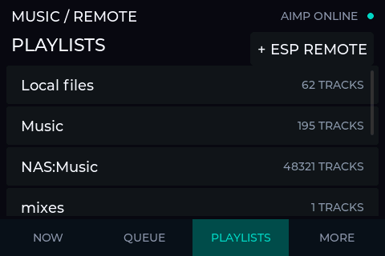

# Music Remote for ESP32-S3

A standalone AIMP remote for the Smart Panlee / Wireless-Tag SC01 Plus 3.5-inch
ESP32-S3 touchscreen. It speaks the AIMP MonkeyMote plug-in protocol directly,
uses LVGL 9, and presents a landscape, typography-first interface inspired by
the clarity of Microsoft Zune.

It is a working remote, and it is also a toy project and worked example of an
agentic software workflow: almost all of the code, documentation, tests and
hardware qualification were produced by AI coding agents (OpenAI Codex and
Anthropic Claude Code) under human direction. They work from GitHub issues
as specifications, and their pull requests are reviewed by another set of
agents. See [How this project is built](#how-this-project-is-built).

## Device UI

These are framebuffer captures from the physical 480x320 device, not desktop
mockups. CI validates every image referenced here and requires UI-changing pull
requests to include refreshed device evidence.

| Now playing | 48,321-track queue |
|---|---|
|  |  |
| Playlists | Media library |
|  |  |
| Display settings | Advanced AIMP controls |
|  |  |

## Implemented controls

- Play, pause, stop, previous, next, seek, volume, shuffle, and repeat modes.
- Live now-playing metadata, playback state, position, and per-track artwork.
- Browse AIMP playlists, switch the active playlist, and browse its queue.
- Page, browse A-Z, and search title/artist across very large SD-backed queues.
- Reuse a validated persisted large-playlist index after reboot, with an
  explicit `CACHED` state and a manual authoritative refresh.
- Tap a queue item to play it; long-press to remove it.
- Long-press `CLEAR` to clear the active playlist.
- Long-press an inactive playlist to delete it.
- Long-press `+ ESP REMOTE` to create a playlist named `ESP Remote`.
- Persistent on-device Wi-Fi, AIMP connection, brightness, screen-off, and
  flip-screen (for upside-down enclosures) settings, with automatic
  reconnection and `.local` host resolution.
- Capability-gated manual equalizer and sleep timer controls.
- Explicitly confirmed computer sleep, restart, and shutdown actions when the
  AIMP plug-in advertises support.

Current-track cover artwork is fetched, decoded off the UI thread, and cached
on microSD when available. A generated music tile is the fallback for missing
artwork.

Destructive actions deliberately require a long press. The firmware is an
independent interoperable client and is not affiliated with MonkeyMote or AIMP.

## Hardware and toolchain

- Smart Panlee / [Wireless-Tag WT32-SC01 Plus](https://www.aliexpress.com/w/wholesale-WT32-SC01-Plus.html) (ESP32-S3, ST7796 480x320 LCD, FT5x06 touch, 2 MB PSRAM)
- ESP-IDF 5.5.4
- `espp/smartpanlee-sc01-plus` managed component
- LVGL 9, with UI text in bitmap fonts derived from Microsoft's Selawik
  (SIL Open Font License 1.1; see `main/fonts/README.md`). The bundled
  Montserrat font (SIL Open Font License 1.1) is the symbol fallback.

## Configure, build, and flash

Install/activate ESP-IDF, then:

```sh
cp .env.example .env
# Edit .env with the local Wi-Fi and AIMP plug-in settings.
# PLAYLIST_STORAGE=auto prefers microSD and falls back to internal flash.
tools/configure.sh
idf.py build
idf.py -p /dev/ttyACM0 flash monitor
```

The configure step compiles first-boot defaults into the local firmware image.
Changes made under Settings are stored in NVS and take precedence on later
boots; connection changes apply after restart. `.env`, generated configuration,
dependencies, and `build/` are ignored; never publish a binary built with real
credentials.

## Touch controls

| Surface | Tap | Long press |
|---|---|---|
| Main play button | Play/pause | Stop |
| Progress / volume | Set value on release | — |
| Queue row | Play track | Remove track |
| Playlist row | Activate, or open folder | Delete when inactive and writable |
| `CLEAR` | — | Clear active playlist |
| `+ ESP REMOTE` | — | Create playlist |

The four bottom destinations divide the entire navigation bar into contiguous
120×46 hit regions. Other buttons include an additional four-pixel touch margin
outside their visible bounds to tolerate finger movement on release.

## Validation and diagnostics

The board exposes a LAN-only diagnostic framebuffer at
`http://musicremote.local/screenshot.ppm?page=now`. Valid page names are
`now`, `queue`, `playlists`, `more`, `az`, `search`, `library`, `lyrics`,
`playback-settings`, `connection-settings`, `display-settings`,
`storage-settings`, and `advanced-settings`. View-only physical-widget samples
are available as `advanced-demo`, `equalizer-demo`, and `power-confirm-demo`;
they retain the real connection state and cannot enqueue control commands. For
non-mutating index diagnostics, the queue capture also
accepts `start=10000`, `filter=A`, or `search=Mars`. This endpoint has no
authentication; use the firmware only on a trusted Wi-Fi network.
The diagnostics server task stack is allocated from PSRAM so it does not
compete with the AIMP client for the ESP32-S3's smaller internal-memory pool.

See [the product specification](docs/SPEC.md), [protocol notes](docs/PROTOCOL.md),
[UI rationale](docs/UI.md), and [test record](docs/TESTING.md).

Run `make check-visual` to validate the README gallery and visual-evidence
policy locally. Hardware screenshots are captured and reviewed by a person;
CI verifies committed evidence but never fabricates a device capture.

For read-only advanced-state qualification against a live AIMP host, run:

```sh
python3 tools/protocol_probe.py --env .env advanced
```

The reversible mutation command requires the explicit
`--confirm-live-mutations` flag, makes a best-effort restoration of captured
baselines, and never sends a computer-power action. Do not interrupt it: a
process kill or persistent connection loss can prevent restoration and leave
EQ changed or a stop-playback timer active. See the protocol notes before use.

## How this project is built

The repository doubles as a sandbox for running a firmware project mostly
hands-off with coding agents. The human owner writes or approves
specifications, holds the hardware, and decides what ships; agents do the
rest under the rules in [`AGENTS.md`](AGENTS.md).

### Ship workflow

1. **Issue as specification.** Each change starts as a GitHub issue from the
   [feature template](.github/ISSUE_TEMPLATE/feature.yml), which has an
   outcome, acceptance criteria (build, live AIMP, physical-device and visual
   evidence), and the state that must be protected while testing. Agents
   file the issue themselves when the request arrives in conversation.
2. **Branch and implement.** The agent works on a branch named for the issue
   and keeps commits narrowly tied to its acceptance criteria.
3. **Qualify on real hardware.** It builds with the pinned ESP-IDF, runs the
   host-side policy tests, flashes the board on the bench, watches the serial
   log, and checks the change against a live AIMP server. When the agent
   cannot touch the screen, it asks the human to.
4. **Capture evidence.** UI changes are proven with framebuffer captures
   pulled from the device's diagnostic endpoint, reviewed, and committed
   under `artifacts/`. CI requires before/after images and refreshed artifact
   evidence for UI-source changes, and checks README screenshot integrity.
   Reviewers verify device provenance and gallery freshness.
5. **Pull request.** The PR closes the issue and records commands, device
   state, and test results in the [template](.github/pull_request_template.md).
6. **Agent code review** with ccr-local (below). The agent answers every
   review thread with what it did (`Fixed in <commit>`, `Won't fix: …`,
   `Deferred to #<issue>`) and resolves it.
7. **Merge**, then flash the merged build back onto the device.

[`docs/TESTING.md`](docs/TESTING.md) is the running hardware-qualification
log the agents keep as they go.

### ccr-local code review

ccr-local is the maintainer's local code-review tool (not currently
published). It is modelled on the pipeline behind GitHub Copilot code
review, but runs on a local machine against an existing Claude or Codex
subscription instead of GitHub's hosted service. At a high level:

- **A council of reviewers.** Several independent agent sessions (four by
  default) review the same pull request in parallel. Each sees the diff, the
  PR description, and the repository's instruction files such as
  `AGENTS.md`. Each has read-only access to the whole checkout and one
  sandboxed, offline shell for a narrow verification step. Findings are
  structured tool calls with a file, line, category, and rationale, not
  free-form prose.
- **Deduplication and voting.** Findings are merged across members,
  classified as `critical`, `moderate`, or `nit` with the diff in view, and
  kept only if enough members independently raised them. Findings also get
  titles, grouping, and a check against comments already on the PR.
- **Publication.** Surviving findings become inline PR review threads plus an
  overview with an approval-readiness verdict. The tool sets a
  `ccr-local/review` commit status: failure when a finding blocks, success
  otherwise.
- **Converging rounds.** The first review of a PR is full. Later rounds
  review only what changed, know every earlier finding, and treat a
  settled thread reply as final, so the same issue isn't raised twice.
- **Per-repository configuration** lives in [`.ccr.json`](.ccr.json):
  - extra instruction files;
  - paths kept out of the reviewed diff, such as secrets;
  - `max_rounds`;
  - `final_review.paths`, the critical files whose changes owe a final full
    review.

  Here those are the AIMP protocol client, the on-disk playlist index,
  NVS settings and credentials, the untrusted cover-art decoder, host power
  actions, the boot/diagnostics path, and the partition table.

This repository runs one review round per PR by default, plus a short
incremental follow-up when fixes are pushed, so the final commit carries a
review status. Further rounds, up to three in total, happen only while a
`critical` finding remains in one of those critical files. Findings that are
not fixed become GitHub issues labelled `deferred`.

A `main` branch ruleset enforces the gate. Changes land only through pull
requests, and merging requires the CI evidence check, a `ccr-local/review`
status on the exact head commit, and every review thread resolved. Early PRs requested GitHub's built-in `@codex review` instead,
which never responded. Those PRs were reviewed retroactively with ccr-local,
and the findings were triaged and fixed on `main` under issue #33.

## Security note

The legacy remote protocol authenticates the session but does not provide a
modern encrypted transport. Treat the Wi-Fi network as a trust boundary, use a
unique plug-in password, and do not expose TCP port 19371 to the internet.
