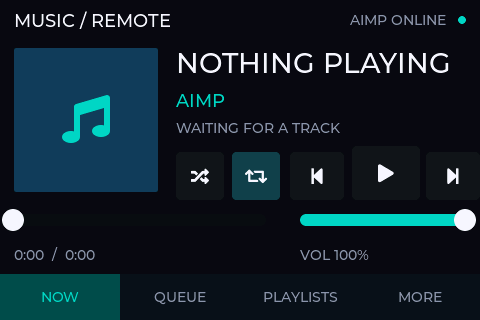
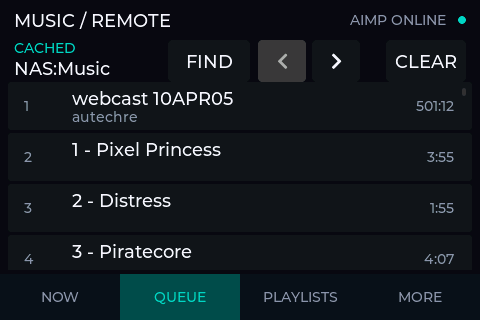
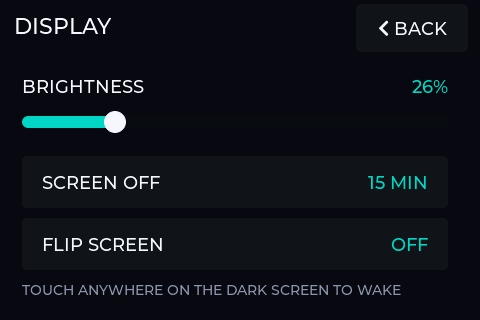
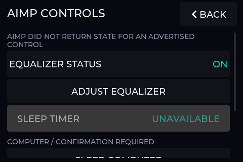

# Music Remote for ESP32-S3

A standalone AIMP remote for the Smart Panlee / Wireless-Tag SC01 Plus 3.5-inch
ESP32-S3 touchscreen. It speaks the AIMP MonkeyMote plug-in protocol directly,
uses LVGL 9, and presents a landscape, typography-first interface inspired by
the clarity of Microsoft Zune.

## Device UI

These are framebuffer captures from the physical 480x320 device, not desktop
mockups. CI validates every image referenced here and requires UI-changing pull
requests to include refreshed device evidence.

| Now playing | 48,321-track queue |
|---|---|
|  |  |
| Playlists | Media library |
|  |  |
| Display settings | Advanced AIMP controls |
|  |  |

## Implemented controls

- Play, pause, stop, previous, next, seek, volume, shuffle, and repeat modes.
- Live now-playing metadata, playback state, position, and per-track artwork.
- Browse AIMP playlists, switch the active playlist, and browse its queue.
- Page, browse A-Z, and search title/artist across very large SD-backed queues.
- Reuse a validated persisted large-playlist index after reboot, with an
  explicit `CACHED` state and a manual authoritative refresh.
- Tap a queue item to play it; long-press to remove it.
- Long-press `CLEAR` to clear the active playlist.
- Long-press an inactive playlist to delete it.
- Long-press `+ ESP REMOTE` to create a playlist named `ESP Remote`.
- Persistent on-device Wi-Fi, AIMP connection, brightness, screen-off, and
  flip-screen (for upside-down enclosures) settings, with automatic
  reconnection and `.local` host resolution.
- Capability-gated manual equalizer and sleep timer controls.
- Explicitly confirmed computer sleep, restart, and shutdown actions when the
  AIMP plug-in advertises support.

Current-track cover artwork is fetched, decoded off the UI thread, and cached
on microSD when available. A generated music tile is the fallback for missing
artwork.

Destructive actions deliberately require a long press. The firmware is an
independent interoperable client and is not affiliated with MonkeyMote or AIMP.

## Hardware and toolchain

- Smart Panlee / [Wireless-Tag WT32-SC01 Plus](https://www.aliexpress.com/w/wholesale-WT32-SC01-Plus.html) (ESP32-S3, ST7796 480x320 LCD, FT5x06 touch, 2 MB PSRAM)
- ESP-IDF 5.5.4
- `espp/smartpanlee-sc01-plus` managed component
- LVGL 9 with the Selawik typeface (SIL Open Font License 1.1) for UI text and
  the bundled Montserrat font (SIL Open Font License 1.1) as the symbol fallback

## Configure, build, and flash

Install/activate ESP-IDF, then:

```sh
cp .env.example .env
# Edit .env with the local Wi-Fi and AIMP plug-in settings.
# PLAYLIST_STORAGE=auto prefers microSD and falls back to internal flash.
tools/configure.sh
idf.py build
idf.py -p /dev/ttyACM0 flash monitor
```

The configure step compiles first-boot defaults into the local firmware image.
Changes made under Settings are stored in NVS and take precedence on later
boots; connection changes apply after restart. `.env`, generated configuration,
dependencies, and `build/` are ignored; never publish a binary built with real
credentials.

## Touch controls

| Surface | Tap | Long press |
|---|---|---|
| Main play button | Play/pause | Stop |
| Progress / volume | Set value on release | — |
| Queue row | Play track | Remove track |
| Playlist row | Activate, or open folder | Delete when inactive and writable |
| `CLEAR` | — | Clear active playlist |
| `+ ESP REMOTE` | — | Create playlist |

The four bottom destinations divide the entire navigation bar into contiguous
120×46 hit regions. Other buttons include an additional four-pixel touch margin
outside their visible bounds to tolerate finger movement on release.

## Validation and diagnostics

The board exposes a LAN-only diagnostic framebuffer at
`http://musicremote.local/screenshot.ppm?page=now`. Valid page names are
`now`, `queue`, `playlists`, `more`, `az`, `search`, `library`, `lyrics`,
`playback-settings`, `connection-settings`, `display-settings`,
`storage-settings`, and `advanced-settings`. View-only physical-widget samples
are available as `advanced-demo`, `equalizer-demo`, and `power-confirm-demo`;
they retain the real connection state and cannot enqueue control commands. For
non-mutating index diagnostics, the queue capture also
accepts `start=10000`, `filter=A`, or `search=Mars`. This endpoint has no
authentication; use the firmware only on a trusted Wi-Fi network.
The diagnostics server task stack is allocated from PSRAM so it does not
compete with the AIMP client for the ESP32-S3's smaller internal-memory pool.

See [the product specification](docs/SPEC.md), [protocol notes](docs/PROTOCOL.md),
[UI rationale](docs/UI.md), and [test record](docs/TESTING.md).

Run `make check-visual` to validate the README gallery and visual-evidence
policy locally. Hardware screenshots are captured and reviewed by a person;
CI verifies committed evidence but never fabricates a device capture.

For read-only advanced-state qualification against a live AIMP host, run:

```sh
python3 tools/protocol_probe.py --env .env advanced
```

The reversible mutation command requires the explicit
`--confirm-live-mutations` flag, makes a best-effort restoration of captured
baselines, and never sends a computer-power action. Do not interrupt it: a
process kill or persistent connection loss can prevent restoration and leave
EQ changed or a stop-playback timer active. See the protocol notes before use.

## Security note

The legacy remote protocol authenticates the session but does not provide a
modern encrypted transport. Treat the Wi-Fi network as a trust boundary, use a
unique plug-in password, and do not expose TCP port 19371 to the internet.
