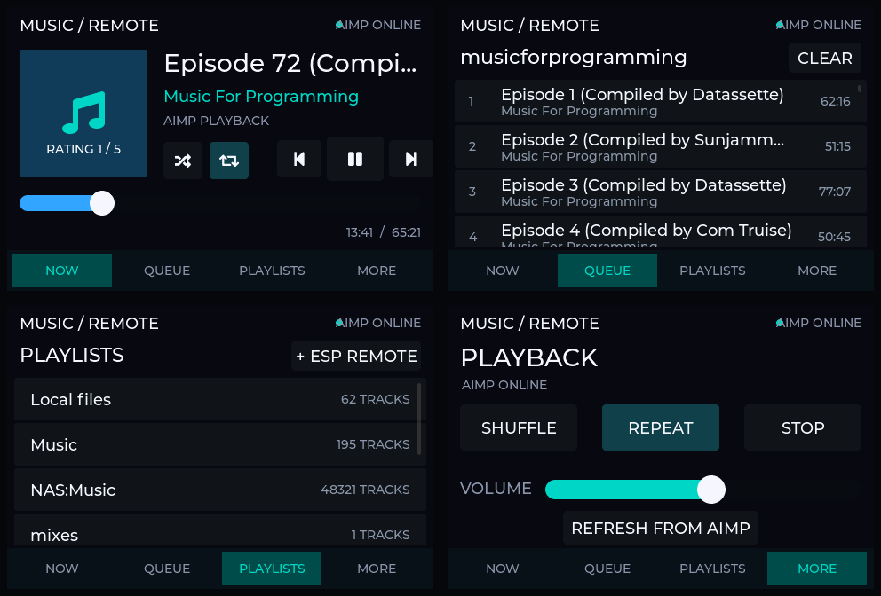

# Music Remote for ESP32-S3

A standalone AIMP remote for the Smart Panlee / Wireless-Tag SC01 Plus 3.5-inch
ESP32-S3 touchscreen. It speaks the AIMP MonkeyMote plug-in protocol directly,
uses LVGL 9, and presents a landscape, typography-first interface inspired by
the clarity of Microsoft Zune.



## Implemented controls

- Play, pause, stop, previous, next, seek, volume, shuffle, and repeat modes.
- Live now-playing metadata, playback state, position, and 0–5 track rating.
- Browse AIMP playlists, switch the active playlist, and browse its queue.
- Page, browse A-Z, and search title/artist across very large SD-backed queues.
- Tap a queue item to play it; long-press to remove it.
- Long-press `CLEAR` to clear the active playlist.
- Long-press an inactive playlist to delete it.
- Long-press `+ ESP REMOTE` to create a playlist named `ESP Remote`.
- Automatic Wi-Fi and AIMP reconnection with `.local` host resolution.

Current cover artwork is not downloaded: the large blue music tile is the
intentional fallback and doubles as the rating control. A bounded cover-art
fetch/cache implementation is tracked in GitHub issue #2.

Destructive actions deliberately require a long press. The firmware is an
independent interoperable client and is not affiliated with MonkeyMote or AIMP.

## Hardware and toolchain

- Smart Panlee / Wireless-Tag WT32-SC01 Plus
- ESP32-S3, ST7796 480x320 LCD, FT5x06 touch, 2 MB PSRAM
- ESP-IDF 5.5.4
- `espp/smartpanlee-sc01-plus` managed component
- LVGL 9 with the bundled Montserrat font (SIL Open Font License 1.1)

## Configure, build, and flash

Install/activate ESP-IDF, then:

```sh
cp .env.example .env
# Edit .env with the local Wi-Fi and AIMP plug-in settings.
# PLAYLIST_STORAGE=auto prefers microSD and falls back to internal flash.
tools/configure.sh
idf.py build
idf.py -p /dev/ttyACM0 flash monitor
```

The configure and build steps compile credentials into the local firmware
image. `.env`, generated configuration, dependencies, and `build/` are ignored;
never publish a binary built with real credentials.

## Touch controls

| Surface | Tap | Long press |
|---|---|---|
| Artwork | Cycle rating 0–5 | — |
| Main play button | Play/pause | Stop |
| Progress / volume | Set value on release | — |
| Queue row | Play track | Remove track |
| Playlist row | Activate, or open folder | Delete when inactive and writable |
| `CLEAR` | — | Clear active playlist |
| `+ ESP REMOTE` | — | Create playlist |

The four bottom destinations divide the entire navigation bar into contiguous
120×46 hit regions. Other buttons include an additional four-pixel touch margin
outside their visible bounds to tolerate finger movement on release.

## Validation and diagnostics

The board exposes a LAN-only diagnostic framebuffer at
`http://musicremote.local/screenshot.ppm?page=now`. Valid page names are
`now`, `queue`, `playlists`, `more`, `az`, and `search`. For non-mutating index
diagnostics, the queue capture also accepts `start=10000`, `filter=A`, or
`search=Mars`. This endpoint has no authentication; use the firmware only on a
trusted Wi-Fi network.

See [the product specification](docs/SPEC.md), [protocol notes](docs/PROTOCOL.md),
[UI rationale](docs/UI.md), and [test record](docs/TESTING.md).

## Security note

The legacy remote protocol authenticates the session but does not provide a
modern encrypted transport. Treat the Wi-Fi network as a trust boundary, use a
unique plug-in password, and do not expose TCP port 19371 to the internet.
