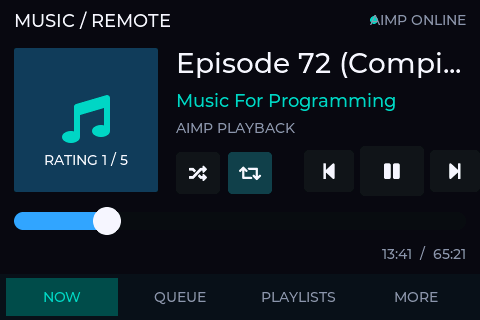

# Validation record

Date: 2026-11-07 (Australia/Melbourne)

## Build and hardware

- ESP-IDF 5.5.4 build passed for `esp32s3`.
- Firmware: `0x1b0f90` bytes (approximately 1.77 MB).
- App partition: `0x3f0000`; 57% remained free.
- Flashed and hash-verified over `/dev/ttyACM0`.
- Boot identified ESP32-S3 revision 0.2, 2 MB PSRAM, and 16 MB physical flash
  (the firmware intentionally uses an 8 MB image/partition layout).
- PSRAM initialization and memory test passed.

## Live network

- Joined the configured WPA2 network and acquired `192.168.227.64`.
- Resolved the configured AIMP host by mDNS and authenticated on TCP 19371.
- Parsed the live eight-playlist collection and active queue, including a
  48,321-track playlist, without unbounded UI allocation.
- Reversibly changed and confirmed volume (35,388 to 34,364), shuffle (off to
  on), and repeat (mode 2 to mode 0), then restored the exact baseline values.
- Switched away from and restored the live `musicforprogramming` playlist; the
  original playing state, position, repeat, shuffle, and volume were restored
  after discovering that AIMP uses `-1` only as a read-current sentinel.
- A 45-second reset-to-online serial trace completed without panic after the
  LVGL transition regression found during the preceding soak was fixed.

## Visual inspection

The following are captures of the LVGL framebuffer served by the physical
board, not desktop mockups:

Inspection covered orientation, navigation selection, clipping, list text,
live state, theme-state colours, and touch target size.
