# Validation record

Date: 2026-11-08 (Australia/Melbourne)

The records below include the settings/capability branch's physical build,
flash, boot, and framebuffer qualification. Its live AIMP portion remains
pending because the configured Windows host did not accept TCP connections.

## Build and hardware

- ESP-IDF 5.5.4 build passed for `esp32s3`.
- Firmware: `0x1b3320` bytes (approximately 1.78 MB).
- App partition: `0x3f0000`; 57% remained free.
- Flashed and hash-verified over `/dev/ttyACM0`.
- Boot identified ESP32-S3 revision 0.2, 2 MB PSRAM, and 16 MB physical flash
  (the firmware intentionally uses an 8 MB image/partition layout).
- PSRAM initialization and memory test passed.

## Live network

- Joined the configured WPA2 network and acquired `192.168.227.64`.
- Resolved the configured AIMP host by mDNS and authenticated on TCP 19371.
- Parsed the live eight-playlist collection. Requesting the 48,321-track
  `NAS:Music` playlist produced a single 1,223,088-byte wire payload; the
  firmware drained it without allocation, stayed connected, and presented the
  bounded-memory `PLAYLIST TOO LARGE` state instead of crashing.
- Reversibly changed and confirmed volume (35,388 to 34,364), shuffle (off to
  on), and repeat (mode 2 to mode 0), then restored the exact baseline values.
- Switched away from and restored the live `musicforprogramming` playlist; the
  original playing state, position, repeat, shuffle, and volume were restored
  after discovering that AIMP uses `-1` only as a read-current sentinel.
- A 45-second reset-to-online serial trace completed without panic after the
  LVGL transition regression found during the preceding soak was fixed.
- A second live trace exposed queue construction starving the CPU 1 idle task;
  queue rows now render in eight-row batches. Two subsequent online soaks ran
  beyond the prior watchdog point without a watchdog report or panic.
- Live type 41 evidence confirmed playlist flag bit 0 means folder and bit 1
  means protected/read-only. Activating the protected `Lossless` playlist was
  accepted and returned playlist ID 6 with 184 entries.
- Live queue testing confirmed playback subcommand 10 takes a zero-based row,
  not the metadata item ID (which was `-1` for this AIMP playlist). The exact
  prior track, 351,750 ms position, playback state, repeat, shuffle, and volume
  were restored after the activation test.
- No server-side playlist pagination or search request was found. The current
  queue UI pages decoded results in 100-row chunks; full-library A-Z/search is
  specified as a microSD-preferred persistent index in issue #7 because the
  board's 2 MB PSRAM cannot safely retain the wire payload, decoded strings,
  search index, networking, and LVGL state together.
- Commit `f7a2374` was flashed and completed two physical microSD index runs of
  all 48,321 `NAS:Music` tracks from the 1,223,088-byte compressed frame. The
  final run reported completion 89 seconds after boot, stayed authenticated to
  AIMP throughout, served framebuffer requests while the worker was active,
  and neither reset nor started a duplicate rebuild. The resulting first page
  shows real queue rows and the root playlist view resolves AIMP's `-1` current
  sentinel back to playlist ID 2, highlighting `NAS:Music`.
- Commit `f68297c` was flashed after the final index-handoff fixes and completed
  another physical index of the same 48,321-track frame. It reported completion
  about 77 seconds after frame receipt without resetting or dropping the live
  UI/network task. AIMP was then restored to `Local files`.
- Hardware iterations on the same card exposed and fixed three otherwise
  build-clean faults: 4 KiB I/O buffers exhausting the 12 KiB network-task
  stack, write-only staging files being read during final index assembly, and
  synchronous indexing causing AIMP to time out and reconnect. The final design
  keeps bulk buffers on the heap, opens staging streams for readback, and runs
  index construction on a separate task while the network task remains live.
- Commit `36e2d23` was flashed and authenticated after adding monotonic local
  progress extrapolation. Two physical framebuffer captures of the same
  playing track advanced from 24:38 to 24:51, with matching progress-knob
  movement, while fresh AIMP type-6 packets remain authoritative sync points.
  The final build uses decisecond slider units so the 10 Hz interpolation is
  also reflected in the control position between elapsed-label ticks.
  The implementation is designed to freeze the last extrapolated value while
  offline, wait for a new type-6 sync after reconnect, preserve an optimistic
  seek target until a post-send host reply, and update elapsed text when
  duration is unknown. Offline freeze, reconnect sync, and unknown-duration
  behavior still require targeted physical tests; this run directly validates
  normal playing progress and a panic-free online soak only.
- The issue #7 completion build replaced the multi-file index assembler with a
  single atomic staging file and rebuilt all 48,321 `NAS:Music` rows from the
  1,223,088-byte compressed response in about 110 seconds. The device remained
  authenticated and responsive. A reset then received the identical response,
  validated its source hash, and published the cached index in about 6 seconds
  without rewriting it.
- Read-only physical diagnostics loaded the page beginning at global row 10,001,
  returned A-prefix results with global rows 6, 30, 35, and 86, and found artist
  substring matches for `Mars` at global rows including 483 and 5,258. This
  confirms page/search results do not substitute local result positions for the
  AIMP queue row.
- Issue #27 reproduced `INDEX TASK FAILED` on the physical board after the
  screenshot, Wi-Fi, LVGL, and artwork services were active. At failure time,
  internal RAM had 12,699 bytes free but its largest contiguous block was only
  3,584 bytes, so the transient 12 KiB index-task stack could not be allocated.
  The production fix reserves one persistent 8 KiB worker before LVGL and
  Wi-Fi can fragment the heap, then wakes that same worker for every build. Its
  stack is in PSRAM when the backend is microSD, preserving the internal/DMA
  pool the SD driver needs; the SPIFFS fallback instead uses an internal stack
  because a flash-backed worker cannot safely run from PSRAM. It never creates
  or self-deletes a task in the low-memory path and cannot overlap a successor
  with the prior worker's tail state. The worker opens its build gate before
  consuming the final supersession marker and enqueueing any retry; a host test
  covers the marker-at-finish race that previously could lose a refresh. The
  initial qualification build indexed the same 48,321-row `NAS:Music` response
  twice in one boot; the second began with only a 2,688-byte largest internal
  block, directly exercising the condition that previously failed. The final
  persistent-worker build was then requalified against the same playlist. Two
  temporary qualification boots removed `INDEX.DAT` before connection (that
  hook is not in production), forcing the full LZ4 decode, index/search-key
  construction, and SD promotion path. Both rebuilt all 48,321 rows; their
  minimum-free-stack readings were 4,404 and 4,420 bytes. Thus the worst run
  used at most 3,788 bytes of the 8 KiB stack and retained about 4.3 KiB of
  headroom. The cached path retained 4,884 bytes. The screenshot framebuffer
  payload remains PSRAM-backed, while the HTTP task keeps ESP-IDF's safer
  default internal stack. Physical diagnostics after the forced rebuild loaded
  global row 10,001 and returned the expected A-prefix rows 6, 30, 35, and 86
  while the UI and network remained responsive.
- Reboot qualification confirmed that the index files persist, but the current
  initial-state flow still transfers the complete active playlist and validates
  or rebuilds the index on every connection. Avoiding that transfer with a
  bounded cache-invalidation policy is tracked separately in issue #28.
- A temporary flash-only qualification build mounted the 4 MB `storage` SPIFFS
  partition with 3,757 KiB usable. It rejected `NAS:Music` as
  `FLASH INDEX TOO LARGE` without a reset, then—using a lowered streaming
  threshold only to exercise the same path—built and promoted a 195-track,
  16,418-byte decoded fixture. Switching to a different fixture inside the
  15-minute protection interval reused the previous 195-row index and displayed
  `INDEX STALE - RETRY LATER`; an SPIFFS `access()` incompatibility exposed by
  this run was replaced with `stat()` checks. The production 512 KiB threshold
  and `auto` microSD preference were restored afterward.
- Recovery fault injection physically moved the valid 48,321-row SD index to
  `INDEX.BAK`, wrote a three-byte corrupt `INDEX.DAT`, and rebooted through the
  production recovery constructor. The backup was restored and the complete
  queue became ready from the matching source response in about 6.5 seconds.
- A separate temporary hash-mismatch build was reset 15 seconds after the full
  NAS frame began rebuilding. The immediate reset also made the card miss all
  three mount attempts, so the device safely mounted internal SPIFFS and stayed
  online instead of crashing. The clean production image then remounted the
  card, removed about 4 MB of interrupted staging files, retained/reused the
  prior promoted 48,321-row index, and restored the card's reported free space
  from 60,595 MB to 60,599 MB on the following boot.
- Commit `f8cedf8` passed the issue #8 guarded live-mutation run, then was built,
  hash-verified, and flashed as the clean production qualification image. Its
  boot log reported app version `f8cedf8`, mounted the 60,786 MB microSD card,
  passed the 2 MB PSRAM test, joined Wi-Fi, resolved the AIMP host, and
  authenticated without a panic. The live run created a uniquely named
  disposable playlist, populated it with one media-library item, played it,
  and sought to 78,639 ms of a 157,279 ms track. AIMP replied with type 6 at
  78,639 ms while remaining in the playing state. The same run
  changed rating 0 to 1 and back to 0, removed the item (type 32), repopulated
  and cleared the playlist (type 20), then deleted it (type 7/subcommand 16).
  Type 42 creation and every resulting playlist count were confirmed by a
  follow-up read; no validation playlist remained afterward.
- The mutation probe logs only request/response message types, payload sizes,
  counts, and command-result bytes. It recorded create `42/36`, population
  `21/20`, seek `7/5`, rating `10/1`, removal `32/8`, clear `20/4`, and delete
  `7/5`; authentication material and payload bodies were not captured.
- The run restored its observed playlist, stopped/playing state, position,
  volume 49,679, shuffle off, repeat mode 2, and rating 0. After qualification,
  AIMP was explicitly returned to the original `Local files` playlist in the
  stopped state.
- For a separate post-seek device run, the host sought the playing track to
  90,000 ms and confirmed type 6 state `playing` at that position before the
  board connected. The physical display subsequently advanced from 2:52 to
  2:59 with matching progress-knob movement. AIMP was again returned to
  `Local files`, stopped at 0 ms, after both framebuffers were captured.
- A temporary flash-only diagnostic hook sent LVGL's real long-press and click
  events to the play control. Playback was running at 6:47 before the long
  press, stopped at 0:00 on the long press, and remained stopped after the
  release/click event. This directly proves the play control's long-press
  suppression latch consumes the subsequent click; the queue and playlist
  delete latches use the same event pattern but were not directly injected in
  this run. The hook was removed before the production build.
- Issue #2 protocol qualification requested type 4/subcommand 3 at 144 by 144
  from a live Bandcamp track. AIMP returned type 8 with a 2,941-byte JPEG after
  the four-byte length and 16-byte identity fields; a track without artwork
  returned the empty type 13 response. The firmware build then booted with the
  2 MB PSRAM test passing, mounted the 60,786 MB microSD card, authenticated to
  AIMP, decoded the JPEG on its cover worker, and rendered it on the physical
  SC01 Plus. The framebuffer below shows correct colour/order and aspect ratio,
  while the live timeline advanced to 1:09 / 2:37 and volume remained 75%.
  The first SD write exposed that this FatFS mount requires 8.3 names; the
  cache now uses an eight-character digest filename and verifies the complete
  128-bit track identity stored inside each entry, preventing truncated-name
  collisions from displaying incorrect art. A reset then logged a 2,941-byte
  cache hit and decoded it successfully before processing the fresh host reply.
- Review qualification then drove 36 consecutive live track changes from the
  physical panel firmware. For the first 24, a temporary two-entry threshold
  forced the unchanged production pruning path on every over-capacity write;
  uppercase FatFS 8.3 entries were counted and one entry was pruned after each
  fresh 2,941-byte JPEG. A further 12 transitions recorded stable low-water
  marks: internal RAM settled at 16,179 bytes and PSRAM at 1,201,084 bytes,
  with no later decline, panic, reset, stale cover, or unresponsive capture.
  The production thresholds (128 entries/16 MiB on SD) were restored afterward.
- A separate `MUSICREMOTE_PLAYLIST_STORAGE_OVERRIDE=flash` build mounted the
  3.7 MiB SPIFFS partition with the SD path disabled. It wrote a fresh
  2,941-byte artwork entry for key `4cc712f2c3e1aed612e028c10ff0ec38`;
  after a hardware reset the same key logged a cache hit and decoded before the
  live host reply. The qualification-only storage override and diagnostics were
  removed before the production build.
- Issue #3 live protocol qualification returned 3,358 artists, 5,647 albums,
  338 genres, and 383 composers from the four library roots. A whole-library
  search for `Beatles` returned 135 track rows; browsing artist `The Beatles`
  returned 17 albums and selecting `Abbey Road (Remastered)` returned eight
  tracks. The current live track had no lyrics and produced the expected empty
  type-36 body after its fixed 20-byte header.
- The guarded mutation matrix then removed its seeded scratch row, browsed the
  exact live artist/album with type 39, and successfully re-enqueued the chosen
  result with type 40. It cleared that row, searched the exact title with type
  24, re-enqueued the chosen search row with type 44, cleared it again, and
  activated the scratch playlist, selected its appended row 0, and confirmed
  the exact searched title began playing. It then stopped playback, cleared
  the row, and deleted the scratch playlist. Follow-up reads confirmed every count. The
  original playlist 0 remained stopped at 0 ms with volume 49,679, shuffle
  off, and repeat mode 2 after restoration.
- The review build was hash-verified and flashed after the board was recovered
  from an unresponsive black-screen state. Its boot trace passed the 2 MB PSRAM
  test, mounted the 60,786 MB microSD card, joined Wi-Fi, resolved the AIMP host,
  and authenticated. Physical framebuffer diagnostics then loaded all four live
  media-library roots without a panic: 3,358 artists, 5,647 albums, 338 genres,
  and 383 composers. The first two visibly reported the intentional bounded-row
  retained-result limit while paging the first 25 rows.
- Commit `16951f7` was built with ESP-IDF 5.5.4, hash-verified, and flashed to
  the physical ESP32-S3. Boot reported the exact commit, passed the 2 MB PSRAM
  test, loaded persistent settings from NVS, mounted the 60,786 MB microSD card,
  and joined Wi-Fi at `192.168.227.64`. The configured AIMP machine resolved but
  TCP port 19371 timed out during this run, so no live server mutation was
  attempted and capability status correctly remained waiting/offline.
- Physical framebuffer inspection covered the new scrollable Settings menu,
  Playback, Display, and Storage/About submenus plus the returned Now Playing
  page. The live Connection submenu was also inspected without preserving a
  repository artifact: both passwords rendered as fixed masks, while host,
  port, and SSID remained editable. Brightness and timeout controls were not
  clipped, the Back target occupied its full rectangle, and the rating overlay
  was absent. The inspection found and fixed two diagnostic-only regressions:
  long settings route names exceeded the query buffer, and base-page selection
  did not initially dismiss a settings overlay. Entering Storage/About and then
  requesting Now Playing on the final flash proved the overlay reset.
- The adversarial review of PR #15 found invalid editable WPA credentials,
  incomplete first-boot persistence, and misleading NVS-failure reporting.
  Commit `2a091d4` resolves those findings: Wi-Fi passwords are restricted to
  open networks, 8-63 printable-ASCII passphrases, or 64 hexadecimal digits;
  the complete settings snapshot is schema-seeded and repaired atomically;
  newer schemas fail without mutation; and storage failures remain visible
  instead of being reported as successful saves. The single focused blocker
  re-review passed with no remaining P1 or P2 finding.
- The clean `2a091d4` build passed all 13 protocol tests and the expanded host
  settings-policy test, used 1,986,016 bytes (48%) of the app partition, and
  was hash-verified after flashing. Boot identified the exact commit and
  ESP-IDF 5.5.4, passed the embedded 2 MB PSRAM test, loaded the complete NVS
  settings snapshot, mounted the 60,786 MB microSD card, and joined Wi-Fi at
  `192.168.227.64`. The refreshed physical Storage/About framebuffer showed
  `SETTINGS STORAGE: NVS OK` without clipping. The AIMP host still resolved to
  `192.168.227.178`, but TCP port 19371 timed out, so live AIMP validation was
  not claimed.
- The blank-screen overlay is topmost and clickable before the backlight is
  disabled, and the wake path waits for pointer release before hiding it. This
  structurally prevents the first wake press from reaching an underlying
  control. A literal finger-driven timeout/wake/second-touch sequence was not
  performed during this unattended run and remains a manual hardware check.
- The advanced-controls implementation was initially qualified against the
  official AIMP 5 MonkeyMote plug-in DLL, then its type-48 response and setter
  layouts were confirmed against the configured live AIMP 5 host during issue
  #17. It adds strict bounded parsers for equalizer state, preset names, and
  sleep state; it mutates only a previously validated complete equalizer body.
  The focused host test covers valid bodies, malformed lengths and fixed
  fields, out-of-range bands, preset termination, timer bounds, state requests,
  exact setter confirmation, and power-action bounds.
- The issue #4 advanced build passed ESP-IDF 5.5.4 `make check`: all 13 Python
  protocol tests, the settings-policy host test, and the new advanced-controls
  host test passed. The 1,993,584-byte image left 52% of the configured app
  partition free and was hash-verified after flashing over `/dev/ttyACM0`.
  Boot again passed the 2 MB PSRAM memory test, loaded NVS settings, mounted the
  60,786 MB microSD card, and joined Wi-Fi at `192.168.227.64` without a panic.
- During the earlier issue #4 qualification the board resolved
  `aerocore.local` to `192.168.227.178`, but TCP port 19371 timed out from both
  the read-only host probe and device. No live advanced mutation was claimed
  for that earlier run, and no computer sleep, restart, or shutdown packet was
  sent.
- Physical framebuffer inspection covered the capability-gated advanced menu,
  complete scrollable equalizer, full-screen shutdown confirmation, and real
  offline state. A view-only diagnostic fixture renders supported controls
  while retaining the real offline connection state, so touches cannot enqueue
  commands. Sequential capture found and fixed a fixture-state leak; requesting
  the ordinary advanced page afterward now restores `WAITING FOR AIMP
  CAPABILITIES` and hides every unsupported control.
- The single adversarial review found two P2 issues: diagnostic fixtures could
  enqueue against a concurrently online real session, and the equalizer's
  effective slider target was 38 px high. An explicit fixture-mode guard now
  blocks every advanced mutation and restores authoritative state on exit; the
  slider target is now 46 px. The permitted focused re-review found both issues
  resolved with no remaining P1, P2, or blocker.
- The post-merge completion audit opened issue #17 for evidence that cannot be
  inferred from passing builds: live advanced-control mutation/restoration,
  disconnect/reconnect timeline behavior, and a literal finger-driven blank /
  wake / second-touch sequence. At audit time `aerocore.local` resolved to
  `192.168.227.178`, but returned no ping replies and TCP 19371 timed out from
  both the host probe and device.
- Issue #17 adds a read-only advanced-state probe and a separately confirmed
  reversible matrix. On 2026-11-08 the live host reported capability mask
  `0x000000000077ffff`, enabled EQ at -2.6 dB with 20 bands, and 25 preset
  names. A guarded type-48 write changed preamp to -1.6 dB, AIMP returned the
  exact requested body, and the exact -2.6 dB baseline was restored. Static
  inspection of the official AIMP 5 plug-in confirmed its setter applies
  preamp and band gains but not the response's enabled byte, so the UI presents
  enabled as static status rather than a false control. The host advertises a
  sleep-timer capability but returned no state baseline; the probe reports that
  control unavailable and deliberately refuses to mutate it. No
  type-4/subcommand-14 power packet was emitted. The expanded suite passes all
  23 Python protocol tests.
- The issue #17 adversarial review found three P2 restoration-safety and
  documentation gaps. Mutation bookkeeping now precedes ambiguous socket
  writes, restoration retries once after reconnect, timer restoration requires
  the exact captured payload, and interruption limitations are explicit. Fault
  injection covers an applied-then-failed write and disabled-but-different
  timer responses. The permitted focused re-review found all three resolved
  with no remaining blocker, P1, or P2 in scope.
- Issue #20 reproduced the framebuffer failure on merged commit `463f456`:
  response headers reached the host, but the first image-body write eventually
  returned `EAGAIN`. A packet trace confirmed the host acknowledged every
  received byte immediately and kept an open receive window. Together with the
  successful PSRAM-backed configuration, the behavior is consistent with
  device-side internal lwIP transmit-memory exhaustion rather than a WLAN or
  HTTP-client failure. The production configuration now
  lets Wi-Fi/lwIP prefer the board's 2 MB PSRAM, while retaining six static TX
  buffers and eight cache entries so the screenshot server still has enough
  internal RAM for its task stack. The handler builds the 460,815-byte PPM in
  PSRAM and uses ESP-IDF's ordinary fixed-length response API.
- The final issue #20 qualification build passed the PSRAM test, mounted the
  60,786 MB microSD card, joined Wi-Fi, started the screenshot server, and
  authenticated to live AIMP. Four consecutive physical captures of the main
  and Advanced Controls screens each returned HTTP 200 with exactly 460,815
  bytes in 0.52-1.05 seconds. Visual inspection confirmed the right-aligned
  `AIMP ONLINE` indicator, main progress/volume layout, enabled equalizer
  status, capability-gated sleep-timer row, and confirmation-gated computer
  power action; the device remained online and responsive throughout.
- A temporary, uncommitted qualification hook exercised the same command queue
  used by the touch UI while every request simultaneously returned a complete
  framebuffer. Live AIMP confirmed volume 100% to 98%, shuffle off to on,
  repeat mode 2 to off, stopped to playing, and a five-second seek; elapsed
  time advanced from 0:03 to 0:09. A full active-playlist refresh then ran
  alongside ten consecutive 460,815-byte captures, all HTTP 200 in
  0.99-1.14 seconds, while playback advanced to 0:21. Restoration returned
  volume, shuffle, repeat, and playback to the captured baseline. The hook was
  removed before the production build.
- Issue #22 was reproduced against live AIMP: capability mask
  `0x000000000077ffff` advertised sleep-timer support, EQ state arrived, and no
  type-51 timer baseline arrived. On the physical board the Advanced Controls
  screen first showed EQ `ON` and timer `LOADING`; after the bounded five-second
  deadline it retained EQ `ON`, changed only the timer to disabled
  `UNAVAILABLE`, and displayed the omitted-state explanation. Both physical
  framebuffers returned HTTP 200 with exactly 460,815 bytes, and the AIMP
  session remained online. The focused host test covers complete, partial,
  pre-deadline, timeout, retry, late-response, reset, and mutation-gate policy
  through the same availability state machine and readiness predicates used by
  the client and UI, including stale-known EQ/timer state.

## Visual inspection

The following are captures of the LVGL framebuffer served by the physical
board, not desktop mockups. They were recaptured from commit `36e2d23` after
the compact side-by-side progress/volume row and queue-page buttons were
flashed:


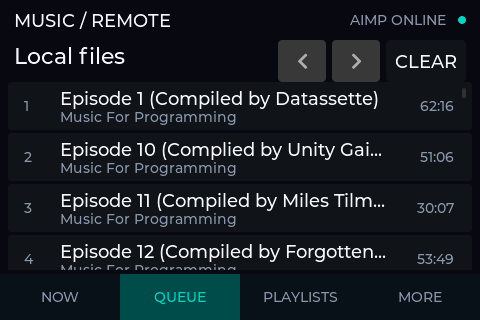
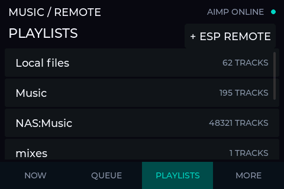


Inspection covered orientation, navigation selection, clipping, list text,
live state, theme-state colours, the right-aligned connection indicator, main
volume control, the compact timeline layout, queue paging controls, and
contiguous full-height bottom touch targets.

The issue #8 captures below directly cover locally extrapolated progress,
post-seek progress, and long-press suppression. On the same playing track,
elapsed time advances from 1:43 to 1:49 with corresponding progress-knob
movement despite no intervening authoritative type 6 update. After a separately
confirmed seek to 1:30, the display advances from 2:52 to 2:59. The long-press
pair shows playback before the gesture and still stopped after release:


The following two large-playlist captures come from commit `f7a2374`, before
`f68297c` moved queue titles to x=48. They do not yet show the current row
layout or a page at row 10,000 or later.

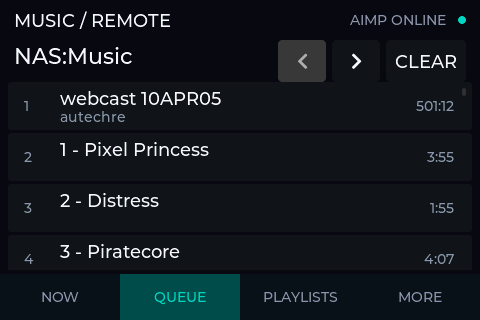


The issue #7 completion captures show the current fixed-size paging and local
search surfaces on the same physical board:


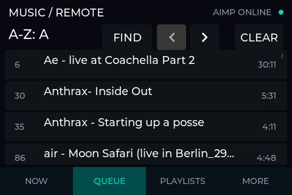

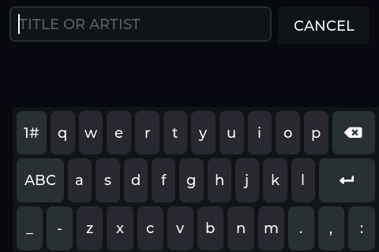

The issue #3 review captures show the physical media-library and lyrics
surfaces. These are live AIMP results, not desktop mockups:


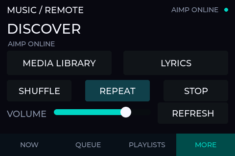

The issue #4 settings captures below are from the final physical-device flow;
the AIMP host was offline, so the capability line intentionally shows its
waiting state:


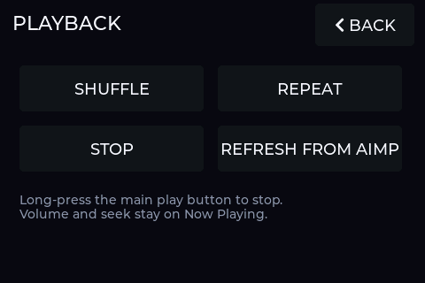

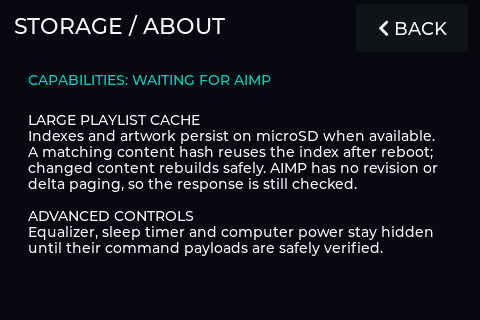
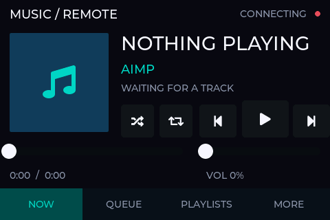

The advanced-control captures below are also from the physical LVGL
framebuffer. The first three use the non-commanding diagnostic fixture for
layout inspection; the fourth proves the real offline capability gate:

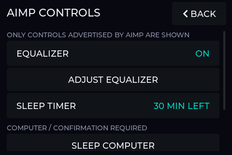
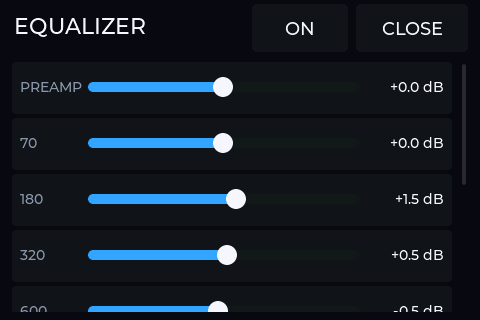
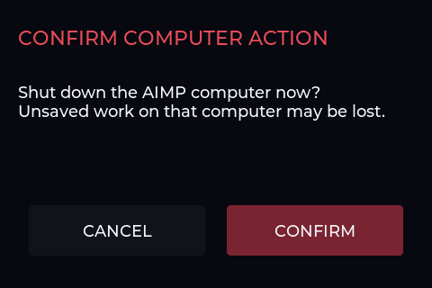
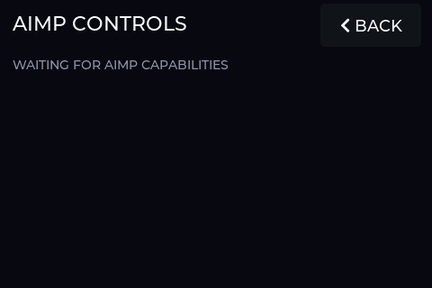

The issue #20 captures below were taken from the physical board after the
PSRAM-backed framebuffer-response fix:


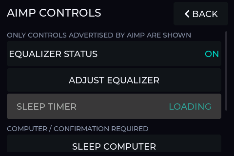

The issue #22 captures show the real advertised-but-omitted timer transition
without using the synthetic Advanced Controls fixture:


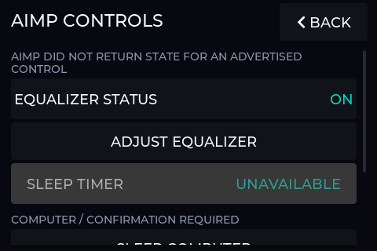

## Persisted large-playlist cache qualification (issue #28)

The physical issue #28 qualification used the same 48,321-row `NAS:Music`
playlist and microSD index as the earlier large-playlist tests. On the first
connection, serial evidence recorded `Streaming 1223088-byte playlist frame`,
then `Indexed 48321 tracks for playlist -1` and an active marker resolved to
playlist ID 2. The source hash matched the existing index, so validation and
marker publication completed without a full rebuild.

After a hardware reset, the next connection logged the persisted identity
(`id=2 count=48321`), deferred the current-queue request, matched that identity
against the root playlist collection, and reported `Reused persisted playlist
index without queue transfer`. No streamed frame or index-worker activity
appeared during the following 12-second observation window. The device loaded
the real first 100 rows, retained global queue row IDs, and exposed the bounded
freshness state in the framebuffer:

Final hardware qualification also caught a startup resource-ordering failure:
publishing the cached page before `httpd_start` could leave no suitable
internal stack block for diagnostics, while starting diagnostics first could
starve the AIMP client. The final build places the supported HTTP server task
stack in PSRAM and starts it before cache publication. A clean reset then
logged the screenshot endpoint, authenticated to `aerocore.local:19371`,
reused playlist ID 2 without a queue transfer, and returned the inspected
480x320 framebuffer below while online.

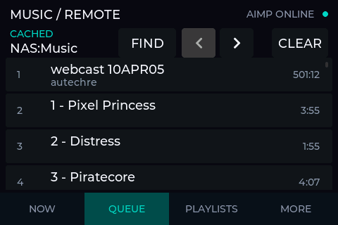

## Flip screen qualification (issue #31)

The first boot of the new firmware migrated the absent `disp_flip` key within
settings schema 1; the following boot logged `Persistent device settings
loaded` without a migration and kept the owner's existing 26% brightness and
15-minute screen-off values. Boot logged `Display orientation: normal`.

On the physical board, tapping Settings → Display → FLIP SCREEN rotated the
panel 180 degrees immediately, and the BACK button, navigation tabs, and
volume slider received touches at the pressed location. After a reset, the
setting persisted and boot logged `Display orientation: flipped`. LVGL
snapshots are independent of panel rotation, so the captures below are
upright in both states:


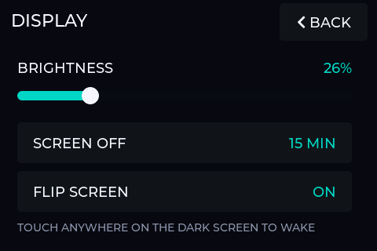

## Retroactive review fixes qualification (issue #33)

Firmware fixes for the retroactive ccr-local findings on #11, #14, #15, #16,
and #30 were built with ESP-IDF 5.5.4. `make check` passed: the build plus the
settings, advanced-control, index-worker, and playlist-cache policy tests,
22 visual-evidence tests, and 30 protocol-probe tests. The build was flashed
to the SC01 Plus. It booted without a panic, kept the persisted flipped
orientation, joined Wi-Fi, and authenticated to `aerocore.local:19371`.

The owner performed these checks against the live AIMP host:

- **Equalizer:** dragging one band and then quickly dragging another; neither
  snapped back nor reset mid-drag.
- **Sleep timer:** selecting END OF TRACK kept that label rather than
  reverting to OFF. The timer was turned off again afterwards.
- **Playback:** play/pause, next/previous, seek, volume, shuffle, and repeat.
- **Playlists:** creating `ESP Remote` and deleting it again.
- **Queue:** tapping a queue row played the selected track.
- **Keyboards:** the settings editor keyboard was fully on screen, Enter
  saved and closed the editor, the `1#` page offered `~ | ^` and backtick,
  and Enter ran a queue search once.

The online Storage/About capture shows both capability lines clear of the
NVS status line. The search capture shows the keyboard anchored fully on
screen; the previous capture clipped its bottom row.


Cover art showed the generic tile during this session, including for an album
that previously rendered. A direct probe of the AIMP host, with the board held
in reset, returned `cover unavailable` for the current track. Firmware built
from unmodified `main` showed the same tile. The missing artwork is therefore
on the AIMP host, not a firmware regression.

Not exercised on hardware:

- **Offline cached-queue browsing:** no persisted large-playlist index was
  present.
- **Throttled internal-flash rebuilds:** the board uses microSD.

## Current-track cover art qualification (issue #41)

While the cTrix album "A for Amiga" played, AIMP showed its cover but the
device showed the generic tile. Live probing with the board held in reset
showed that the type 4/3 cover request takes a queue row (`-1` = current
track) and a maximum edge, not a width and height. Requests for rows 0, 64,
and 100 each returned a different album's cover, and the firmware's `144,
144` asked for queue row 144, which had no artwork.

The fixed firmware requests `-1, 144`. On the SC01 Plus the request decoded a
4,992-byte 144x144 JPEG, and pilotredsun "Achievement" tracks show their
correct cover, matching AIMP. The cache format moved to `MRA2`, so entries
written by earlier builds under the wrong row are refetched.

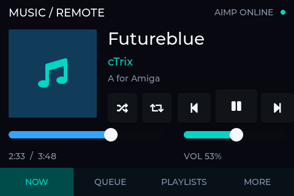
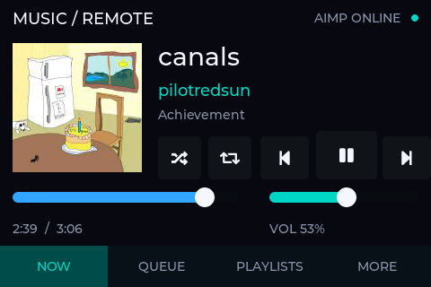

## Cover linger qualification (issue #43)

On the SC01 Plus against the live AIMP host, the owner confirmed these cases:

- Skipping between tracks of one album keeps the cover on screen with no
  blank flash.
- Skipping to a different album swaps directly to its cover.
- Skipping to a track without artwork shows the generic tile within about
  2 seconds.

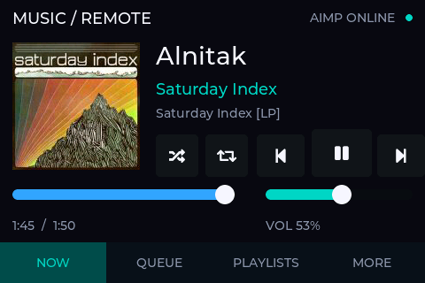

## Selawik UI font and CJK fallback qualification (issue #45)

Date: 2026-11-18. SC01 Plus on `/dev/ttyACM0` (screen flipped), firmware from
this branch merged with #48 and #49, live AIMP at `aerocore.local:19371`.
`fonts/cjk.ttf` (Droid Sans Fallback Full, SHA-256 `2392015530…8240`) was
placed on the card with `make load-data`.

- Boot logs `cjk-font: Loaded /sdcard/fonts/cjk.ttf (3940 KB) at
  14/18/22/28 px; PSRAM cache up to 315 KB; internal RAM free 211 KB, PSRAM
  free 1915 KB`, after `sd_loader` recovery, so the font is opened only once
  the card's interrupted uploads have been resolved.
- LVGL allocates through #48's PSRAM-first allocator; the branch's earlier
  scoped PSRAM preference for tiny_ttf was dropped as redundant.
- After boot, 35 s idle logged no slow-GUI-loop warnings. The only warnings
  come from first render and the initial AIMP sync (worst 135 ms and 342 ms).
- The owner checked curly quotes, dashes, ellipses and Cyrillic in titles,
  CJK composer names in the media library, and scrolling and clipping in QUEUE
  and search: all render, nothing clipped. Device screenshots
  `artifacts/issue45-now-playing.png` (Semibold title and album line) and
  `artifacts/issue45-now-playing-cjk.png` (Japanese title, artist, album).
- Known gap: Droid Sans Fallback has no Hangul syllables, so Korean shows boxes.

## USB microSD loader qualification (issue #49)

Date: 2026-11-18. SC01 Plus on `/dev/ttyACM0` with a 64 GB microSD card,
firmware built from this branch merged with #48 (the PSRAM-first LVGL
allocator, which keeps internal RAM free for SD DMA). The board stayed in the
case; nothing was removed or reset.

- Boot logs `sd_loader: USB microSD loader ready (fonts/, up to 16 MiB)`.
- `make load-data` uploaded `fonts/cjk.ttf` (DroidSansFallbackFull.ttf,
  4,033,576 bytes) in 8.1 s at 488 KB/s with 0 chunk retries. The device
  verified SHA-256 `2392015530438bafc48edfc4aee6d9de2387f627a6134d8ab3dfcc99d21c8240`
  before renaming the temporary file into place.
- A repeat run reported the file already on the card and skipped it.
- `../x` and `mremote/x` were refused (`device refused BEGIN: path`).
- An upload interrupted part-way left the existing file in place: a query
  afterwards still returned the original size and SHA-256.
- Opening the port did not reset the board (RTS is released before DTR), and
  `idf.py monitor` logging and AIMP control kept working with the loader
  installed.

The font itself is used by the CJK fallback in #45, which is qualified there.

## Large-playlist reconnect loop qualification (issue #48)

Date: 2026-11-17. SC01 Plus on `/dev/ttyACM0` with a 64 GB microSD card,
live AIMP host `aerocore.local:19371`, and the 48,321-row `NAS:Music`
playlist (ID 2) active. Firmware image `0x1eb9a0` bytes.

### Root cause

With the reason logging added in this change, the original loop logged:

```
I (20482) monkeymote: Authenticated to aerocore.local:19371
I (22223) monkeymote: Streaming 1223087-byte playlist frame to index storage
W (35271) monkeymote: Closing AIMP connection: AIMP closed the connection (during large playlist transfer)
I (43520) monkeymote: mDNS resolved aerocore.local to 192.168.227.178
```

It repeated every 23 seconds. No client deadline fired: AIMP closed the
socket. Two faults combined.

1. **AIMP liveness.** AIMP drops a client that has sent nothing for about
   10 seconds (`docs/PROTOCOL.md`). The firmware sent a keepalive only after
   10 seconds without receiving, which never happens mid-transfer. A host
   probe reading the frame at 20 KB/s was cut off after 13.4 seconds; with a
   client keepalive every 3 seconds the same read stayed connected for 90
   seconds.
2. **Slow storage after an SD panic.** On boot with a persisted index, the
   100 cached queue rows' LVGL objects were allocated from internal RAM,
   because `malloc()` places blocks under 4 KiB there. Internal free memory
   fell from about 36 KiB to 867 bytes within one 200 ms sample. The microSD
   SPI driver then could not allocate a 512-byte DMA bounce buffer, and
   ESP-IDF panicked (`setup_dma_priv_buffer: Failed to allocate priv RX
   buffer`, `LoadProhibited`) in the artwork cache's directory scan. The reset
   left the card mid-read, so later boots failed to mount it
   (`sdmmc_io_reset: unexpected return`) and fell back to the internal SPIFFS
   partition. SPIFFS writes at about 19 KB/s (135 KB in 7 seconds), so
   the 1.2 MB frame needed about 60 seconds, far beyond AIMP's 10-second
   limit.

### Fixes verified on hardware

- A keepalive is sent whenever the client has sent nothing for 4 seconds, and
  every request deadline (playlist, lyrics, library, library-play, cache
  check, advanced controls, and the equalizer overlay) pauses while a partial
  frame is in flight. Host tests: `tools/test_connection_policy.cpp` and
  `tools/test_advanced_controls.cpp`.
- LVGL uses a PSRAM-first allocator. On the same boot sequence, internal free
  memory stayed at 100 to 118 KiB. Five later runs with an allocation-failure
  hook reported no failure, and no run panicked.
- Each mount attempt first clocks out an SPI-mode CMD12 and idle clocks. After
  a USB chip reset this recovered the card that the panic had left
  unmountable. After the panic's own software reset it did not; the PSRAM
  allocator removes that panic.
- On microSD, the frame streamed in 3.8 to 4.8 seconds in every run, with no
  disconnect.

### Index, cache, and refresh timings

| Case | Serial evidence | Time |
|---|---|---|
| First build, version 3 index | `Indexed 48321 tracks ... (rebuilt)` | 143 to 147 s after a 4.2 s transfer |
| Reset with the persisted marker | `Reused persisted playlist index without queue transfer: id=2 count=48321` | 0.9 s after authentication; no transfer |
| Queue refresh (`refresh=1`) | `Indexed 48321 tracks for playlist -1 in 3035 ms (reused: source hash)` | 4.1 s transfer plus 3.0 s |
| Switch to `Music` (195 rows) and back | `Indexed 48321 tracks for playlist 2 in 25953 ms (reused: content hash)`, then `... in 3079 ms (reused: source hash)` | 26 s, then 3 s for AIMP's follow-up current-queue response |

Before the content hash was added, the same switch back rebuilt the index for
the explicit-ID response (135 seconds), then started a second full rebuild for
AIMP's follow-up current-queue response. The explicit-ID and current-queue responses
differ only in the playlist ID and flags bytes, but they compress to different
frames. Switching to the small playlist left `INDEX.DAT` in place; the switch
back reused it. The playlist switch used a temporary diagnostic build, because
a tap cannot be automated. The switch path itself is the production
`activate_playlist` command, and that diagnostic hook is not committed.

Serial logs from every run above contained no `Closing AIMP connection` line.
After the final flash, the board was left online and idle. AIMP's active
playlist was restored to `NAS:Music` (ID 2), as recorded at the start of the
session.

### Search

AIMP's per-row strings are title, artist, album, and genre
(`docs/PROTOCOL.md`). The version 3 index stores and searches title, artist,
and album. Version 2 files were rejected at boot and rebuilt, not reused.
Searching `messages` returned a title match (row 7873) and the Strawpeople
tracks on the album `No new messages` (rows 39999 to 40001), whose titles and
artist do not contain the word. `autechre` returned artist matches, and A-Z
`M` returned title-prefix matches. Paging to row 48,300 read the final page.

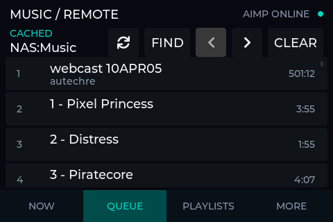
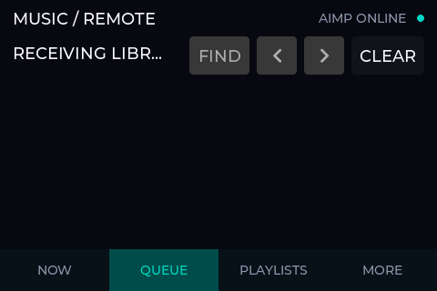
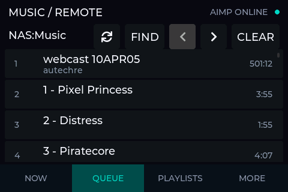
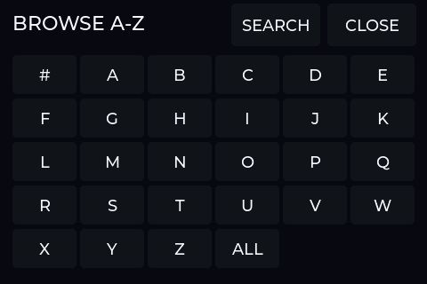
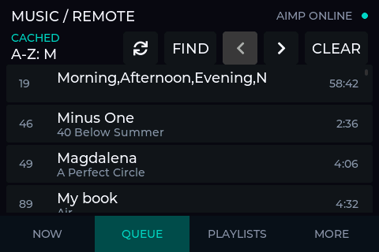
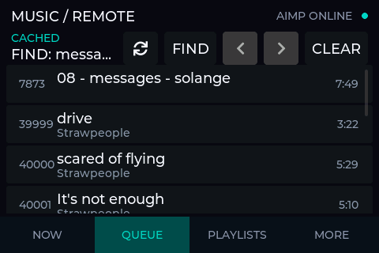
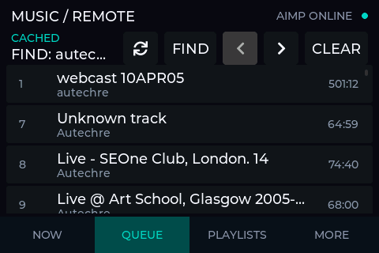
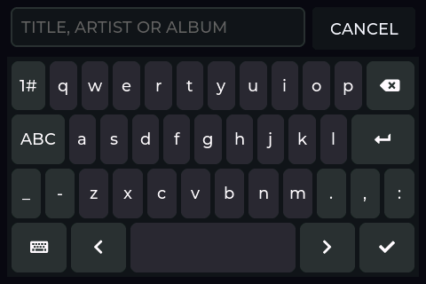
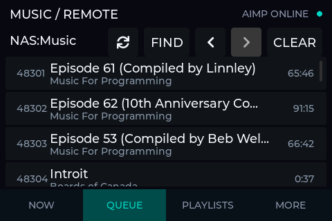

### Owner touch checks

These were not exercised by touch:

- Tap the refresh button on the cached `NAS:Music` queue. The title should
  show the transfer, then the rows should return without `CACHED` in about
  8 seconds.
- Switch to a small playlist and back from the Playlists page. The rows should
  return in about 30 seconds with no full rebuild.
- In FIND > SEARCH, type an album name and confirm that its tracks are listed.
- Confirm that the refresh, FIND, and arrow buttons respond reliably at their
  new 44 px widths.

### Owner touch re-check fixes and review round 1

The owner's touch testing of PR #50 found three problems. Each was then
reproduced on the board. A temporary diagnostic that sent a click to a queue
row, and one that activated a playlist, stood in for touch; neither is
committed.

1. **The playlist reloaded when switching from NOW to QUEUE.** Page
   navigation sends nothing to AIMP: six NOW/QUEUE switches logged no
   request. Host probing showed that play, next, previous, pause, and stop
   produce no change notification. The reload came from tapping a cached
   row. The cached-play path activates the recorded playlist, and AIMP
   answers every activation with a type 12 notification. The firmware treated
   that echo as a change, which made the confirmation reply stale. The tap
   therefore never played, and the 1.2 MB playlist was transferred three
   times while the queue was blank:

   ```
   I (34700) monkeymote: AIMP playlist notification type 12
   I (35561) monkeymote: Streaming 1223087-byte playlist frame to index storage
   I (39479) monkeymote: Deferring large playlist received while index build is active
   I (43871) monkeymote: Streaming 1223087-byte playlist frame to index storage
   ```

   After the fix, the echo is absorbed, one transfer runs, and the rows stay on
   screen during it:

   ```
   I (34714) monkeymote: AIMP echoed our playlist activation; request already outstanding
   I (34719) monkeymote: Streaming 1223087-byte playlist frame to index storage
   I (42167) monkeymote: Indexed 48321 tracks for playlist -1 in 3187 ms (reused: source hash)
   ```

   A refresh likewise kept the visible page during `RECEIVING LIBRARY` and
   `INDEXING LIBRARY`. A switch to `Music` and back now absorbs both echoes,
   transfers once, reuses the index by content digest in 8.0 seconds, and
   persists the cached-queue marker.
2. **Tapping a FIND result did nothing.** This had the same cause, because the
   index was cached after boot. With the fix, tapping `scared of flying` in
   the cached `messages` results played it after one confirmation transfer,
   about 8 seconds. In the authoritative state, tapping an `autechre` result
   played it at once.
3. **After a result is selected**, the filter is cleared and the queue stays
   on the playlist page that holds the track: page 39,901 to 40,000 for
   `scared of flying`, and page 1 to 100 for the Autechre row 8. The row is
   scrolled into view and highlighted when AIMP reports it as current, and
   the neighbouring tracks of the album are listed around it.

Review round 1 also changed content-hash reuse in `playlist_index.cpp`. A
current-playlist (`-1`) response no longer reuses an index stored under an
explicit playlist ID. The response is decoded into a digest before the
internal-flash wear throttle or the free-space reserve applies, so an
unchanged playlist is never reported stale or `SD CARD FULL`. The digest
writes nothing to storage, which cut the switch-back reuse from 26 seconds to
8 seconds.

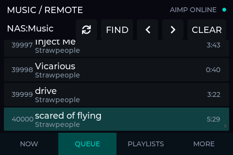
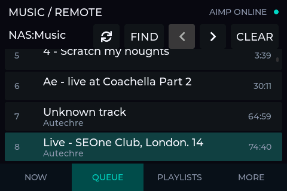
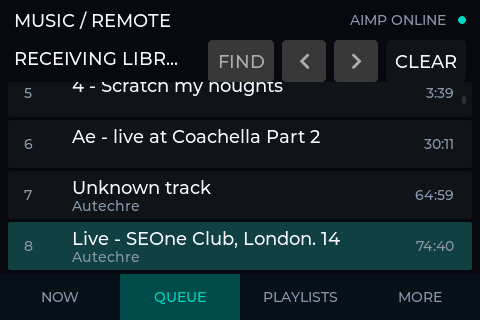

AIMP was left stopped on `NAS:Music` (ID 2), as found.

**Owner touch results (2026-11-18).** The owner's re-check of `2a7b2b9` found
that selecting a track still showed the indexing state for a long time and
did not always play. The optimistic-play design below replaced it. On the
optimistic-play build, the owner confirmed by touch that:

- tapping a queue row, a FIND search result, or an A-Z result plays at once
  and goes to Now Playing;
- the queue then returns to playlist order with the track highlighted;
- switching playlists on the Playlists page behaves as expected.

### Optimistic play, timings, and responsiveness (issue #48)

Tapping a row now sends play-row and play at once, switches to Now Playing,
and verifies afterwards against AIMP's type 5 and 11 reports. A cached queue
first activates its playlist, and that activation's echo is absorbed. The
library append-and-play confirmation is kept, because an appended row must
exist before it can be played.

The measurements below come from serial timestamps on the board, using
temporary diagnostics that are not committed. Those diagnostics sent a click
to a queue row or playlist row, perturbed one expected title, and discarded
the cached index.

| Measurement | Before | After |
|---|---|---|
| Tap to play-row sent | 8 s or never (confirmation transfer) | 17 to 95 ms (11 taps) |
| Tap to verified match | n/a | 0.2 s typical, 2.3 s worst |
| Refresh: request to first byte | 0.86 to 0.89 s | 0.90 s |
| Refresh: transfer | 3.7 s | 3.8 to 4.2 s |
| Refresh: source hash | 2.9 to 3.0 s (re-read) | 0 ms (hashed while streaming) |
| Refresh: hash-match reuse | in the 3.0 s above | 65 to 249 ms |
| Refresh: page publish | 2.1 s | 37 to 95 ms |
| Refresh: request to rows ready | 9.6 to 9.8 s | 4.9 to 5.4 s |
| Switch back to `NAS:Music` | 11.2 s (content digest 6.1 s) | 5.2 s (source hash) |
| First index build | 134.5 s (search pass about 58 s) | 97 to 98 s |
| Build: decode / rows / search area / finalize | 29.8 / 75.6 / 21.3 / 0.2 s (first instrumented) | 15.6-16.8 / 66.6-69.7 / 11.4-14.5 / 0.2 s |
| FIND `messages` (11 matches) | 5.3 s (first instrumented) | 2.7 to 2.8 s (scan 2.6 s) |
| A-Z `M` (2,341 matches) | 5.5 s (first instrumented) | 3.1 s (scan 2.5 s) |

The original refresh path decoded nothing but re-read WIRE.TMP for its hash,
and it loaded each page with three seeks per row in a 10 MB FAT file. Now the
hash is computed while the frame streams, and a page loads with two
sequential reads.

The first-build speedup has two causes. Search entries go to their own
sequential file during the row pass, which replaced 48,321 seeks. The build's
stdio streams use 16 KiB internal DMA-capable buffers, so SD transfers are
multi-sector. The progress bar weights the measured phases. At 52 s of a 98 s
build it showed 55%, and it closed when the build finished.

The perturbed-title test logged `Played row 3 does not match the index;
refreshing`. The refresh followed with the rows still on screen, and the
queue was ready 5.4 s after the request, with no repeated transfer.

**GUI responsiveness.** Each 5-second window logs the worst GUI pass.
Excluding the diagnostic screenshot's own lock hold:

- During refreshes and the 98 s build, the worst pass was 4 to 61 ms (usually
  9 to 31 ms).
- Refilling queue rows takes 6 ms per frame. Before pooling, 8 new rows took
  36 ms, and deleting a page took up to 112 ms.
- A full-screen render, such as a tap changing pages, takes 55 to 130 ms of
  LVGL time. 240 MHz and internal-RAM LVGL objects were each tried and made
  no material difference, so both were left out.
- The index worker now runs at priority 2, below the GUI (4), on the same
  core.
- A tap is handled in the LVGL pass that renders its result, so the Now
  Playing page appears about 70 to 100 ms after the touch.

The search scan runs on the network task. It sends AIMP keepalives during the
scan, because an earlier experiment that took 81 s was dropped by AIMP.

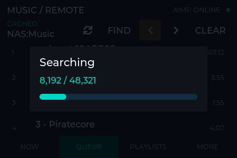
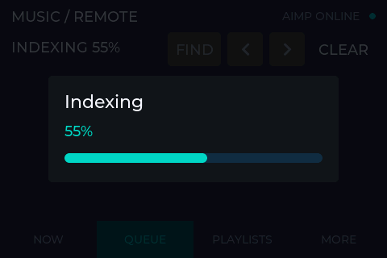
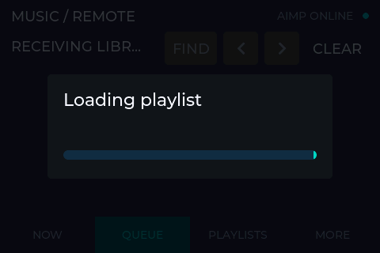

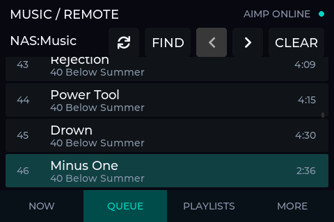
