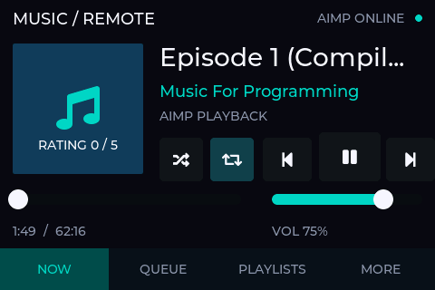
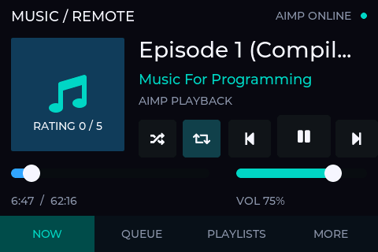
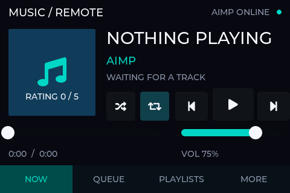
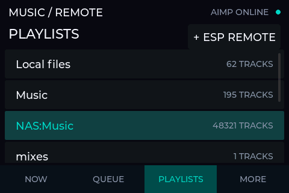
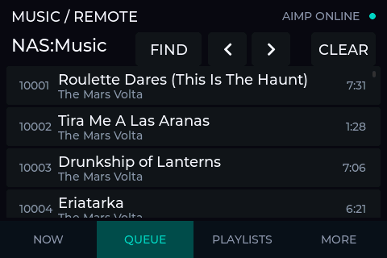
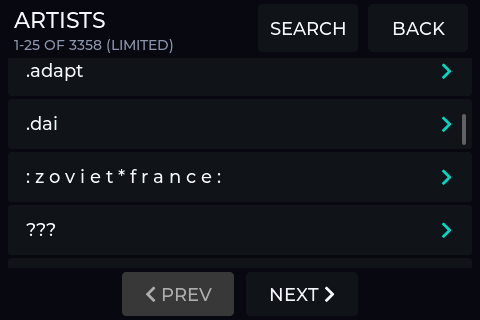
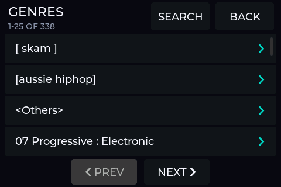
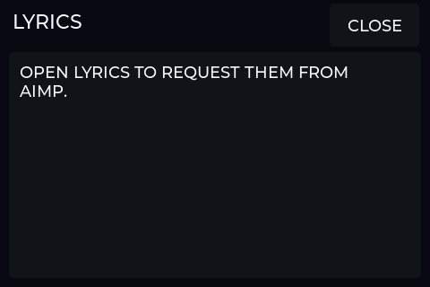
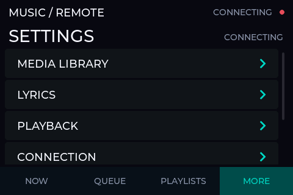

# Validation record

Date: 2026-11-08 (Australia/Melbourne)

The records below include the settings/capability branch's physical build,
flash, boot, and framebuffer qualification. Its live AIMP portion remains
pending because the configured Windows host did not accept TCP connections.

## Build and hardware

- ESP-IDF 5.5.4 build passed for `esp32s3`.
- Firmware: `0x1b3320` bytes (approximately 1.78 MB).
- App partition: `0x3f0000`; 57% remained free.
- Flashed and hash-verified over `/dev/ttyACM0`.
- Boot identified ESP32-S3 revision 0.2, 2 MB PSRAM, and 16 MB physical flash
  (the firmware intentionally uses an 8 MB image/partition layout).
- PSRAM initialization and memory test passed.

## Live network

- Joined the configured WPA2 network and acquired `192.168.227.64`.
- Resolved the configured AIMP host by mDNS and authenticated on TCP 19371.
- Parsed the live eight-playlist collection. Requesting the 48,321-track
  `NAS:Music` playlist produced a single 1,223,088-byte wire payload; the
  firmware drained it without allocation, stayed connected, and presented the
  bounded-memory `PLAYLIST TOO LARGE` state instead of crashing.
- Reversibly changed and confirmed volume (35,388 to 34,364), shuffle (off to
  on), and repeat (mode 2 to mode 0), then restored the exact baseline values.
- Switched away from and restored the live `musicforprogramming` playlist; the
  original playing state, position, repeat, shuffle, and volume were restored
  after discovering that AIMP uses `-1` only as a read-current sentinel.
- A 45-second reset-to-online serial trace completed without panic after the
  LVGL transition regression found during the preceding soak was fixed.
- A second live trace exposed queue construction starving the CPU 1 idle task;
  queue rows now render in eight-row batches. Two subsequent online soaks ran
  beyond the prior watchdog point without a watchdog report or panic.
- Live type 41 evidence confirmed playlist flag bit 0 means folder and bit 1
  means protected/read-only. Activating the protected `Lossless` playlist was
  accepted and returned playlist ID 6 with 184 entries.
- Live queue testing confirmed playback subcommand 10 takes a zero-based row,
  not the metadata item ID (which was `-1` for this AIMP playlist). The exact
  prior track, 351,750 ms position, playback state, repeat, shuffle, and volume
  were restored after the activation test.
- No server-side playlist pagination or search request was found. The current
  queue UI pages decoded results in 100-row chunks; full-library A-Z/search is
  specified as a microSD-preferred persistent index in issue #7 because the
  board's 2 MB PSRAM cannot safely retain the wire payload, decoded strings,
  search index, networking, and LVGL state together.
- Commit `f7a2374` was flashed and completed two physical microSD index runs of
  all 48,321 `NAS:Music` tracks from the 1,223,088-byte compressed frame. The
  final run reported completion 89 seconds after boot, stayed authenticated to
  AIMP throughout, served framebuffer requests while the worker was active,
  and neither reset nor started a duplicate rebuild. The resulting first page
  shows real queue rows and the root playlist view resolves AIMP's `-1` current
  sentinel back to playlist ID 2, highlighting `NAS:Music`.
- Commit `f68297c` was flashed after the final index-handoff fixes and completed
  another physical index of the same 48,321-track frame. It reported completion
  about 77 seconds after frame receipt without resetting or dropping the live
  UI/network task. AIMP was then restored to `Local files`.
- Hardware iterations on the same card exposed and fixed three otherwise
  build-clean faults: 4 KiB I/O buffers exhausting the 12 KiB network-task
  stack, write-only staging files being read during final index assembly, and
  synchronous indexing causing AIMP to time out and reconnect. The final design
  keeps bulk buffers on the heap, opens staging streams for readback, and runs
  index construction on a separate task while the network task remains live.
- Commit `36e2d23` was flashed and authenticated after adding monotonic local
  progress extrapolation. Two physical framebuffer captures of the same
  playing track advanced from 24:38 to 24:51, with matching progress-knob
  movement, while fresh AIMP type-6 packets remain authoritative sync points.
  The final build uses decisecond slider units so the 10 Hz interpolation is
  also reflected in the control position between elapsed-label ticks.
  The implementation is designed to freeze the last extrapolated value while
  offline, wait for a new type-6 sync after reconnect, preserve an optimistic
  seek target until a post-send host reply, and update elapsed text when
  duration is unknown. Offline freeze, reconnect sync, and unknown-duration
  behavior still require targeted physical tests; this run directly validates
  normal playing progress and a panic-free online soak only.
- The issue #7 completion build replaced the multi-file index assembler with a
  single atomic staging file and rebuilt all 48,321 `NAS:Music` rows from the
  1,223,088-byte compressed response in about 110 seconds. The device remained
  authenticated and responsive. A reset then received the identical response,
  validated its source hash, and published the cached index in about 6 seconds
  without rewriting it.
- Read-only physical diagnostics loaded the page beginning at global row 10,001,
  returned A-prefix results with global rows 6, 30, 35, and 86, and found artist
  substring matches for `Mars` at global rows including 483 and 5,258. This
  confirms page/search results do not substitute local result positions for the
  AIMP queue row.
- A temporary flash-only qualification build mounted the 4 MB `storage` SPIFFS
  partition with 3,757 KiB usable. It rejected `NAS:Music` as
  `FLASH INDEX TOO LARGE` without a reset, then—using a lowered streaming
  threshold only to exercise the same path—built and promoted a 195-track,
  16,418-byte decoded fixture. Switching to a different fixture inside the
  15-minute protection interval reused the previous 195-row index and displayed
  `INDEX STALE - RETRY LATER`; an SPIFFS `access()` incompatibility exposed by
  this run was replaced with `stat()` checks. The production 512 KiB threshold
  and `auto` microSD preference were restored afterward.
- Recovery fault injection physically moved the valid 48,321-row SD index to
  `INDEX.BAK`, wrote a three-byte corrupt `INDEX.DAT`, and rebooted through the
  production recovery constructor. The backup was restored and the complete
  queue became ready from the matching source response in about 6.5 seconds.
- A separate temporary hash-mismatch build was reset 15 seconds after the full
  NAS frame began rebuilding. The immediate reset also made the card miss all
  three mount attempts, so the device safely mounted internal SPIFFS and stayed
  online instead of crashing. The clean production image then remounted the
  card, removed about 4 MB of interrupted staging files, retained/reused the
  prior promoted 48,321-row index, and restored the card's reported free space
  from 60,595 MB to 60,599 MB on the following boot.
- Commit `f8cedf8` passed the issue #8 guarded live-mutation run, then was built,
  hash-verified, and flashed as the clean production qualification image. Its
  boot log reported app version `f8cedf8`, mounted the 60,786 MB microSD card,
  passed the 2 MB PSRAM test, joined Wi-Fi, resolved the AIMP host, and
  authenticated without a panic. The live run created a uniquely named
  disposable playlist, populated it with one media-library item, played it,
  and sought to 78,639 ms of a 157,279 ms track. AIMP replied with type 6 at
  78,639 ms while remaining in the playing state. The same run
  changed rating 0 to 1 and back to 0, removed the item (type 32), repopulated
  and cleared the playlist (type 20), then deleted it (type 7/subcommand 16).
  Type 42 creation and every resulting playlist count were confirmed by a
  follow-up read; no validation playlist remained afterward.
- The mutation probe logs only request/response message types, payload sizes,
  counts, and command-result bytes. It recorded create `42/36`, population
  `21/20`, seek `7/5`, rating `10/1`, removal `32/8`, clear `20/4`, and delete
  `7/5`; authentication material and payload bodies were not captured.
- The run restored its observed playlist, stopped/playing state, position,
  volume 49,679, shuffle off, repeat mode 2, and rating 0. After qualification,
  AIMP was explicitly returned to the original `Local files` playlist in the
  stopped state.
- For a separate post-seek device run, the host sought the playing track to
  90,000 ms and confirmed type 6 state `playing` at that position before the
  board connected. The physical display subsequently advanced from 2:52 to
  2:59 with matching progress-knob movement. AIMP was again returned to
  `Local files`, stopped at 0 ms, after both framebuffers were captured.
- A temporary flash-only diagnostic hook sent LVGL's real long-press and click
  events to the play control. Playback was running at 6:47 before the long
  press, stopped at 0:00 on the long press, and remained stopped after the
  release/click event. This directly proves the play control's long-press
  suppression latch consumes the subsequent click; the queue and playlist
  delete latches use the same event pattern but were not directly injected in
  this run. The hook was removed before the production build.
- Issue #2 protocol qualification requested type 4/subcommand 3 at 144 by 144
  from a live Bandcamp track. AIMP returned type 8 with a 2,941-byte JPEG after
  the four-byte length and 16-byte identity fields; a track without artwork
  returned the empty type 13 response. The firmware build then booted with the
  2 MB PSRAM test passing, mounted the 60,786 MB microSD card, authenticated to
  AIMP, decoded the JPEG on its cover worker, and rendered it on the physical
  SC01 Plus. The framebuffer below shows correct colour/order and aspect ratio,
  while the live timeline advanced to 1:09 / 2:37 and volume remained 75%.
  The first SD write exposed that this FatFS mount requires 8.3 names; the
  cache now uses an eight-character digest filename and verifies the complete
  128-bit track identity stored inside each entry, preventing truncated-name
  collisions from displaying incorrect art. A reset then logged a 2,941-byte
  cache hit and decoded it successfully before processing the fresh host reply.
- Review qualification then drove 36 consecutive live track changes from the
  physical panel firmware. For the first 24, a temporary two-entry threshold
  forced the unchanged production pruning path on every over-capacity write;
  uppercase FatFS 8.3 entries were counted and one entry was pruned after each
  fresh 2,941-byte JPEG. A further 12 transitions recorded stable low-water
  marks: internal RAM settled at 16,179 bytes and PSRAM at 1,201,084 bytes,
  with no later decline, panic, reset, stale cover, or unresponsive capture.
  The production thresholds (128 entries/16 MiB on SD) were restored afterward.
- A separate `MUSICREMOTE_PLAYLIST_STORAGE_OVERRIDE=flash` build mounted the
  3.7 MiB SPIFFS partition with the SD path disabled. It wrote a fresh
  2,941-byte artwork entry for key `4cc712f2c3e1aed612e028c10ff0ec38`;
  after a hardware reset the same key logged a cache hit and decoded before the
  live host reply. The qualification-only storage override and diagnostics were
  removed before the production build.
- Issue #3 live protocol qualification returned 3,358 artists, 5,647 albums,
  338 genres, and 383 composers from the four library roots. A whole-library
  search for `Beatles` returned 135 track rows; browsing artist `The Beatles`
  returned 17 albums and selecting `Abbey Road (Remastered)` returned eight
  tracks. The current live track had no lyrics and produced the expected empty
  type-36 body after its fixed 20-byte header.
- The guarded mutation matrix then removed its seeded scratch row, browsed the
  exact live artist/album with type 39, and successfully re-enqueued the chosen
  result with type 40. It cleared that row, searched the exact title with type
  24, re-enqueued the chosen search row with type 44, cleared it again, and
  activated the scratch playlist, selected its appended row 0, and confirmed
  the exact searched title began playing. It then stopped playback, cleared
  the row, and deleted the scratch playlist. Follow-up reads confirmed every count. The
  original playlist 0 remained stopped at 0 ms with volume 49,679, shuffle
  off, and repeat mode 2 after restoration.
- The review build was hash-verified and flashed after the board was recovered
  from an unresponsive black-screen state. Its boot trace passed the 2 MB PSRAM
  test, mounted the 60,786 MB microSD card, joined Wi-Fi, resolved the AIMP host,
  and authenticated. Physical framebuffer diagnostics then loaded all four live
  media-library roots without a panic: 3,358 artists, 5,647 albums, 338 genres,
  and 383 composers. The first two visibly reported the intentional bounded-row
  retained-result limit while paging the first 25 rows.
- Commit `16951f7` was built with ESP-IDF 5.5.4, hash-verified, and flashed to
  the physical ESP32-S3. Boot reported the exact commit, passed the 2 MB PSRAM
  test, loaded persistent settings from NVS, mounted the 60,786 MB microSD card,
  and joined Wi-Fi at `192.168.227.64`. The configured AIMP machine resolved but
  TCP port 19371 timed out during this run, so no live server mutation was
  attempted and capability status correctly remained waiting/offline.
- Physical framebuffer inspection covered the new scrollable Settings menu,
  Playback, Display, and Storage/About submenus plus the returned Now Playing
  page. The live Connection submenu was also inspected without preserving a
  repository artifact: both passwords rendered as fixed masks, while host,
  port, and SSID remained editable. Brightness and timeout controls were not
  clipped, the Back target occupied its full rectangle, and the rating overlay
  was absent. The inspection found and fixed two diagnostic-only regressions:
  long settings route names exceeded the query buffer, and base-page selection
  did not initially dismiss a settings overlay. Entering Storage/About and then
  requesting Now Playing on the final flash proved the overlay reset.
- The adversarial review of PR #15 found invalid editable WPA credentials,
  incomplete first-boot persistence, and misleading NVS-failure reporting.
  Commit `2a091d4` resolves those findings: Wi-Fi passwords are restricted to
  open networks, 8-63 printable-ASCII passphrases, or 64 hexadecimal digits;
  the complete settings snapshot is schema-seeded and repaired atomically;
  newer schemas fail without mutation; and storage failures remain visible
  instead of being reported as successful saves. The single focused blocker
  re-review passed with no remaining P1 or P2 finding.
- The clean `2a091d4` build passed all 13 protocol tests and the expanded host
  settings-policy test, used 1,986,016 bytes (48%) of the app partition, and
  was hash-verified after flashing. Boot identified the exact commit and
  ESP-IDF 5.5.4, passed the embedded 2 MB PSRAM test, loaded the complete NVS
  settings snapshot, mounted the 60,786 MB microSD card, and joined Wi-Fi at
  `192.168.227.64`. The refreshed physical Storage/About framebuffer showed
  `SETTINGS STORAGE: NVS OK` without clipping. The AIMP host still resolved to
  `192.168.227.178`, but TCP port 19371 timed out, so live AIMP validation was
  not claimed.
- The blank-screen overlay is topmost and clickable before the backlight is
  disabled, and the wake path waits for pointer release before hiding it. This
  structurally prevents the first wake press from reaching an underlying
  control. A literal finger-driven timeout/wake/second-touch sequence was not
  performed during this unattended run and remains a manual hardware check.

## Visual inspection

The following are captures of the LVGL framebuffer served by the physical
board, not desktop mockups. They were recaptured from commit `36e2d23` after
the compact side-by-side progress/volume row and queue-page buttons were
flashed:

Inspection covered orientation, navigation selection, clipping, list text,
live state, theme-state colours, the right-aligned connection indicator, main
volume control, the compact timeline layout, queue paging controls, and
contiguous full-height bottom touch targets.

The issue #8 captures below directly cover locally extrapolated progress,
post-seek progress, and long-press suppression. On the same playing track,
elapsed time advances from 1:43 to 1:49 with corresponding progress-knob
movement despite no intervening authoritative type 6 update. After a separately
confirmed seek to 1:30, the display advances from 2:52 to 2:59. The long-press
pair shows playback before the gesture and still stopped after release:

The following two large-playlist captures come from commit `f7a2374`, before
`f68297c` moved queue titles to x=48. They do not yet show the current row
layout or a page at row 10,000 or later.

The issue #7 completion captures show the current fixed-size paging and local
search surfaces on the same physical board:

The issue #3 review captures show the physical media-library and lyrics
surfaces. These are live AIMP results, not desktop mockups:

The issue #4 settings captures below are from the final physical-device flow;
the AIMP host was offline, so the capability line intentionally shows its
waiting state:

