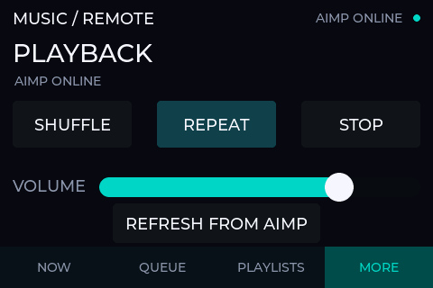
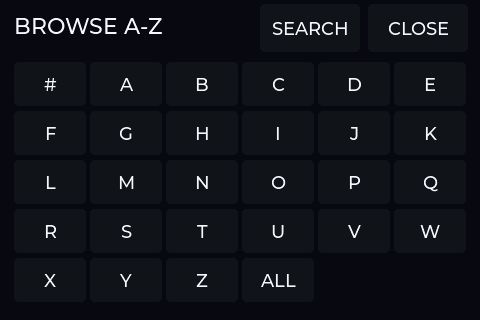

# Validation record

Date: 2026-11-08 (Australia/Melbourne)

## Build and hardware

- ESP-IDF 5.5.4 build passed for `esp32s3`.
- Firmware: `0x1b3320` bytes (approximately 1.78 MB).
- App partition: `0x3f0000`; 57% remained free.
- Flashed and hash-verified over `/dev/ttyACM0`.
- Boot identified ESP32-S3 revision 0.2, 2 MB PSRAM, and 16 MB physical flash
  (the firmware intentionally uses an 8 MB image/partition layout).
- PSRAM initialization and memory test passed.

## Live network

- Joined the configured WPA2 network and acquired `192.168.227.64`.
- Resolved the configured AIMP host by mDNS and authenticated on TCP 19371.
- Parsed the live eight-playlist collection. Requesting the 48,321-track
  `NAS:Music` playlist produced a single 1,223,088-byte wire payload; the
  firmware drained it without allocation, stayed connected, and presented the
  bounded-memory `PLAYLIST TOO LARGE` state instead of crashing.
- Reversibly changed and confirmed volume (35,388 to 34,364), shuffle (off to
  on), and repeat (mode 2 to mode 0), then restored the exact baseline values.
- Switched away from and restored the live `musicforprogramming` playlist; the
  original playing state, position, repeat, shuffle, and volume were restored
  after discovering that AIMP uses `-1` only as a read-current sentinel.
- A 45-second reset-to-online serial trace completed without panic after the
  LVGL transition regression found during the preceding soak was fixed.
- A second live trace exposed queue construction starving the CPU 1 idle task;
  queue rows now render in eight-row batches. Two subsequent online soaks ran
  beyond the prior watchdog point without a watchdog report or panic.
- Live type 41 evidence confirmed playlist flag bit 0 means folder and bit 1
  means protected/read-only. Activating the protected `Lossless` playlist was
  accepted and returned playlist ID 6 with 184 entries.
- Live queue testing confirmed playback subcommand 10 takes a zero-based row,
  not the metadata item ID (which was `-1` for this AIMP playlist). The exact
  prior track, 351,750 ms position, playback state, repeat, shuffle, and volume
  were restored after the activation test.
- No server-side playlist pagination or search request was found. The current
  queue UI pages decoded results in 100-row chunks; full-library A-Z/search is
  specified as a microSD-preferred persistent index in issue #7 because the
  board's 2 MB PSRAM cannot safely retain the wire payload, decoded strings,
  search index, networking, and LVGL state together.
- Commit `f7a2374` was flashed and completed two physical microSD index runs of
  all 48,321 `NAS:Music` tracks from the 1,223,088-byte compressed frame. The
  final run reported completion 89 seconds after boot, stayed authenticated to
  AIMP throughout, served framebuffer requests while the worker was active,
  and neither reset nor started a duplicate rebuild. The resulting first page
  shows real queue rows and the root playlist view resolves AIMP's `-1` current
  sentinel back to playlist ID 2, highlighting `NAS:Music`.
- Commit `f68297c` was flashed after the final index-handoff fixes and completed
  another physical index of the same 48,321-track frame. It reported completion
  about 77 seconds after frame receipt without resetting or dropping the live
  UI/network task. AIMP was then restored to `Local files`.
- Hardware iterations on the same card exposed and fixed three otherwise
  build-clean faults: 4 KiB I/O buffers exhausting the 12 KiB network-task
  stack, write-only staging files being read during final index assembly, and
  synchronous indexing causing AIMP to time out and reconnect. The final design
  keeps bulk buffers on the heap, opens staging streams for readback, and runs
  index construction on a separate task while the network task remains live.
- Commit `36e2d23` was flashed and authenticated after adding monotonic local
  progress extrapolation. Two physical framebuffer captures of the same
  playing track advanced from 24:38 to 24:51, with matching progress-knob
  movement, while fresh AIMP type-6 packets remain authoritative sync points.
  The final build uses decisecond slider units so the 10 Hz interpolation is
  also reflected in the control position between elapsed-label ticks.
  The implementation is designed to freeze the last extrapolated value while
  offline, wait for a new type-6 sync after reconnect, preserve an optimistic
  seek target until a post-send host reply, and update elapsed text when
  duration is unknown. Those edge cases still require targeted physical tests;
  this run directly validates normal playing progress and a panic-free online
  soak only.
- The issue #7 completion build replaced the multi-file index assembler with a
  single atomic staging file and rebuilt all 48,321 `NAS:Music` rows from the
  1,223,088-byte compressed response in about 110 seconds. The device remained
  authenticated and responsive. A reset then received the identical response,
  validated its source hash, and published the cached index in about 6 seconds
  without rewriting it.
- Read-only physical diagnostics loaded the page beginning at global row 10,001,
  returned A-prefix results with global rows 6, 30, 35, and 86, and found artist
  substring matches for `Mars` at global rows including 483 and 5,258. This
  confirms page/search results do not substitute local result positions for the
  AIMP queue row.
- A temporary flash-only qualification build mounted the 4 MB `storage` SPIFFS
  partition with 3,757 KiB usable. It rejected `NAS:Music` as
  `FLASH INDEX TOO LARGE` without a reset, then—using a lowered streaming
  threshold only to exercise the same path—built and promoted a 195-track,
  16,418-byte decoded fixture. Switching to a different fixture inside the
  15-minute protection interval reused the previous 195-row index and displayed
  `INDEX STALE - RETRY LATER`; an SPIFFS `access()` incompatibility exposed by
  this run was replaced with `stat()` checks. The production 512 KiB threshold
  and `auto` microSD preference were restored afterward.

## Visual inspection

The following are captures of the LVGL framebuffer served by the physical
board, not desktop mockups. They were recaptured from commit `36e2d23` after
the compact side-by-side progress/volume row and queue-page buttons were
flashed:

Inspection covered orientation, navigation selection, clipping, list text,
live state, theme-state colours, the right-aligned connection indicator, main
volume control, the compact timeline layout, queue paging controls, and
contiguous full-height bottom touch targets.

The following two large-playlist captures come from commit `f7a2374`, before
`f68297c` moved queue titles to x=48. They do not yet show the current row
layout or a page at row 10,000 or later.

The issue #7 completion captures show the current fixed-size paging and local
search surfaces on the same physical board:

